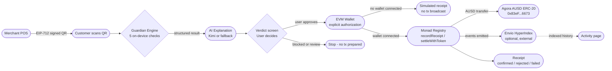
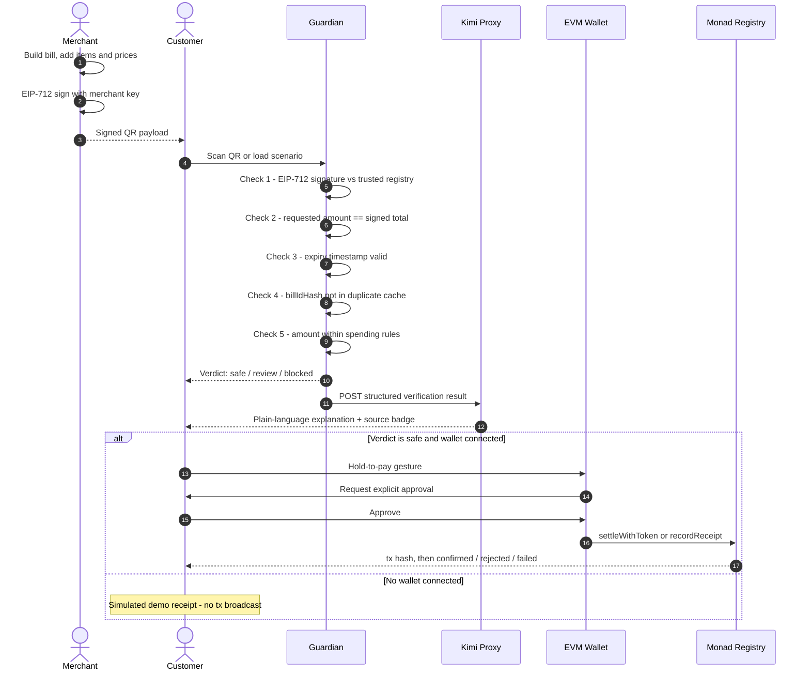

# Monveil
### Know before you approve.

Monveil is an evidence-first payment verification layer for stablecoin payments on Monad. Before a user authorizes a payment, Monveil checks the available evidence behind the request and explains what they are actually approving.

It is not a wallet replacement. It is the verification step between receiving a payment request and deciding whether to act on it.

[](https://monveil.vercel.app/)
[](https://testnet.monadexplorer.com/address/0x8a82a7314fbf17a590420B8d7De3044ab21f633B)
[](https://vitest.dev)
[](https://www.typescriptlang.org)
[](LICENSE)

---

## Table of Contents

- [The Problem](#the-problem)
- [The Solution](#the-solution)
- [Live Deployments](#live-deployments)
- [System Architecture](#system-architecture)
- [Payment Flow](#payment-flow)
- [Guardian Verification Engine](#guardian-verification-engine)
- [AI Explanations](#ai-explanations)
- [Blockchain and Settlement](#blockchain-and-settlement)
- [Passkeys, PRF and Receipt Privacy](#passkeys-prf-and-receipt-privacy)
- [Envio HyperIndex](#envio-hyperindex)
- [Merchant POS and Tampering Demo](#merchant-pos-and-tampering-demo)
- [Demo Scenarios](#demo-scenarios)
- [Technology Stack](#technology-stack)
- [Project Structure](#project-structure)
- [Setup and Local Development](#setup-and-local-development)
- [Security Considerations](#security-considerations)
- [Testing](#testing)
- [Integration Status](#integration-status)
- [Limitations and Planned Work](#limitations-and-planned-work)

---

## The Problem

A merchant hands you a 2,000 rupee invoice and a QR code. You scan it. Your wallet shows an amount and a destination address and asks you to approve.

What the wallet cannot tell you:

- Whether the requested amount matches the itemized invoice
- Whether the request was signed by the actual merchant or by someone who swapped the QR sticker
- Whether this exact request was already used to collect a payment five minutes ago
- Whether the request has expired

The gap between what you intend to pay and what the request is actually asking for is where fraud lives. Monveil closes that gap before any wallet action takes place.

---

## The Solution

**Guardian evaluates the evidence. AI explains the results in plain language. The user controls the authorization decision. The blockchain records supported on-chain actions.**

The merchant signs their invoice using EIP-712 structured data. When the customer scans the QR code, Monveil runs five deterministic checks on-device: signature validity, amount match, expiry, duplicate detection, and spending rules. Only after those checks complete does Monveil call the AI to explain what happened. The AI cannot alter the result. The user then decides whether to proceed.

If the user authorizes payment, the wallet submits the transaction to Monad Testnet. The contract records a cryptographic hash commitment and handles the AUSD token transfer atomically. Private receipt details are encrypted locally using WebAuthn PRF key material and never written to the chain.

---

## Live Deployments

| Resource | Details |
|:---------|:--------|
| Production app | [https://monveil.vercel.app](https://monveil.vercel.app) |
| Verification registry | [`0x8a82a7314fbf17a590420B8d7De3044ab21f633B`](https://testnet.monadexplorer.com/address/0x8a82a7314fbf17a590420B8d7De3044ab21f633B) on Monad Testnet (Chain ID 10143) |
| Deployment tx | [`0x3f59b085...d5054`](https://testnet.monadexplorer.com/tx/0x3f59b0858e9be7431047e2589f397418fb38e44605b5f9b9170f56abf02d5054) confirmed at block 70742452 |
| Deployer address | [`0xf695253560D45fD28eb68Fd03aA1973aCDBa44D8`](https://testnet.monadexplorer.com/address/0xf695253560D45fD28eb68Fd03aA1973aCDBa44D8) |
| Agora AUSD token | [`0x83eF2633E78e7a64B4c7333B32E1858737EB6673`](https://testnet.monadexplorer.com/token/0x83eF2633E78e7a64B4c7333B32E1858737EB6673) on Monad Testnet |
| Repository | [https://github.com/pallaviXD/monveil](https://github.com/pallaviXD/monveil) |

---

## System Architecture



> **Key:** solid arrows = active data flow; dashed arrows = optional integration; the simulated path produces no transaction hash and moves no tokens.

---

## Payment Flow



---

## Guardian Verification Engine

Guardian runs entirely on-device and produces deterministic results. It is the final authority on whether a payment passes. AI explanations and wallet actions follow its output; neither can override it.

### 1. Amount and invoice evidence

All monetary values use integer paise (1 INR = 100 paise) to avoid floating-point errors. Guardian compares the QR-encoded amount against the merchant-signed total.

**Example:** merchant signs a 2,000 rupee invoice. The QR requests 2,200 rupees. Guardian flags the 200 rupee gap and blocks the payment.

Line items are also checked: sum of items plus tax must equal the signed subtotal. Missing line-item evidence returns a `review` result, never a silent pass.

### 2. Merchant authenticity

Bills are signed using EIP-712 typed data. Guardian verifies the signature against a registry of trusted merchant public addresses in `src/services/merchantRegistry.ts`.

A valid signature means the bill was signed by the registered key and has not been altered. It does not prove the merchant is honest or the key is uncompromised. Both the signature and the integrity of key registration matter.

### 3. Expiry

Each request carries a creation timestamp and a 10-minute validity window. Guardian rejects expired requests to prevent stale links from being reused.

### 4. Duplicate and replay protection

Each bill has a unique ID. Guardian hashes it with keccak256 and checks it against a local record of processed bills. The smart contract's `isRecorded` mapping also prevents the same bill hash from being submitted twice on-chain.

### 5. Spending rules

Users configure per-transaction limits and daily caps stored in browser local storage. Guardian blocks payments exceeding those limits. Local storage is appropriate for self-service configuration but is not a tamper-proof boundary against a modified client.

### Verdict states

| Verdict | Meaning |
|:--------|:--------|
| Safe | All available checks passed |
| Review | At least one check is inconclusive (e.g. missing line items) |
| Blocked | At least one check failed - no wallet action is prepared |

---

## AI Explanations

When Guardian finishes, the structured result is sent to `/api/ai/explain` - a server-side proxy in `server/plugin.ts`. The proxy calls the Moonshot Kimi API (`moonshot-v1-8k` via `api.moonshot.cn`) and returns a plain-language explanation.

The AI is instructed to stay grounded in the facts Guardian produced. It cannot alter the verdict or invent evidence.

If the Moonshot API is unavailable or returns an auth error, a deterministic fallback engine generates an accurate explanation from the same structured result. The verdict screen shows a source badge: `KIMI - LIVE` or `RULE-BASED - [REASON]`. The distinction is always visible.

The API key never reaches the browser. It lives in the server environment, accessed only through the middleware proxy.

---

## Blockchain and Settlement

The `MonveilVerificationRegistry` contract at `0x8a82a7314fbf17a590420B8d7De3044ab21f633B` (Monad Testnet) provides three operations:

| Function | What it does |
|:---------|:-------------|
| `recordReceipt(...)` | Records a verification commitment on-chain without moving funds |
| `settleWithToken(...)` | Transfers Agora AUSD from payer to merchant atomically, then records receipt |
| `settleWithNative(...)` | Settles in native MON and records receipt |

All three revert if `isRecorded[billIdHash]` is already true, preventing replay attacks at the contract level.

The app uses `viem` to build and submit the contract call. After submission it polls the RPC and updates the UI with the canonical status.

### Transaction states

| Status | Meaning |
|:-------|:--------|
| Pending | Authorized locally, not yet submitted |
| Submitted | tx hash received, not yet mined |
| Confirmed | Mined with status = success |
| Rejected | Mined but contract reverted, no funds moved |
| Failed | RPC error or transaction dropped |
| Simulated | No wallet connected, local demo only |

When no wallet is connected the receipt is clearly labeled "SIMULATED DEMO RECEIPT". No transaction hash is generated and no tokens are moved.

### Agora AUSD

AUSD token address on Monad Testnet: `0x83eF2633E78e7a64B4c7333B32E1858737EB6673`

Amounts convert from paise to AUSD micro-units (6 decimals) using integer arithmetic:

```
ausdMicroUnits = (paise * 1_000_000 + 4166) / 8333
```

Based on an approximate benchmark of 83.33 INR per USD. For AUSD settlement to complete, the payer needs a sufficient AUSD balance and must approve the registry contract as a spender before the transaction is submitted.

---

## Passkeys, PRF and Receipt Privacy

### Authentication

Sign-in uses W3C WebAuthn Level 3 (`navigator.credentials.create` / `navigator.credentials.get`). On supported devices users authenticate with Touch ID, Face ID, or Windows Hello. No password or seed phrase is needed.

If WebAuthn is unavailable, the app falls back to a simulated session and labels it clearly. The sign-in screen shows `WEBAUTHN - SUPPORTED` or `WEBAUTHN - SIMULATED`.

A passkey authenticates the user as the payer. It does not verify the merchant, invoice, or payment amount. That is Guardian's job.

### PRF receipt vault

Where the browser and authenticator support the WebAuthn PRF extension, Monveil derives a 256-bit AES key from the PRF output and encrypts receipt line items locally using AES-256-GCM with a fresh 12-byte IV.

Only a 32-byte keccak256 hash goes on-chain. Raw receipt contents stay in the local encrypted vault, labeled `keySource: 'prf'`.

When PRF is not supported the app falls back to a software-derived AES key labeled `keySource: 'fallback'`. The receipt page always shows which key source was active. The fallback encrypts the data; it just is not hardware-bound.

---

## Envio HyperIndex

The Envio configuration in `envio/` targets Monad Testnet (network ID 10143), the deployed registry contract, starting from block 70742452. Event handlers in `envio/src/EventHandlers.ts` process `ReceiptRecorded` and `PaymentSettled` events and persist them as typed GraphQL entities.

The Activity page queries this indexed data and shows one of four honest states:

| Badge | Meaning |
|:------|:--------|
| `ENVIO - LIVE` | Indexer reachable and returned records |
| `ENVIO - LIVE (NO EVENTS YET)` | Indexer reachable but no events indexed yet |
| `ENVIO - OFFLINE` | Endpoint unreachable or timed out |
| `ENVIO - ERROR` | Server replied with a GraphQL error |

The default local endpoint is `localhost:8080`, which requires `envio dev` to be running. A hosted deployment requires deploying the indexer from `envio/` to the Envio platform. The Activity page degrades gracefully when unavailable.

---

## Merchant POS and Tampering Demo

The merchant interface at `/merchant` lets you build a bill interactively, sign it with EIP-712, and generate a scannable QR code.

### Step-by-step tampering demonstration

1. Open `/merchant` - add items to build a 2,000 rupee bill
2. Click **Sign Bill (EIP-712)** to generate the signed QR
3. Open `/scan` and scan the QR
4. Guardian runs five checks - all pass on the legitimate bill
5. Return to merchant screen, click **Tamper QR (+200)**
6. Scan the tampered QR
7. Guardian detects the 2,200 requested vs 2,000 signed - both seal and amount checks fail
8. Verdict is blocked, AI explains the 200 rupee discrepancy
9. No wallet action is prepared - the customer sees the mismatch before any approval

---

## Demo Scenarios

Five pre-built scenarios are available from `/home` for immediate evaluation:

| Scenario | Signed total | QR requests | Verdict | Reason |
|:---------|:------------|:-----------|:--------|:-------|
| Honest bill | Rs 1,050 | Rs 1,050 | Safe | All 5 checks pass |
| Tampered QR | Rs 1,050 | Rs 1,250 | Blocked | Seal + amount mismatch |
| Already paid | Rs 1,050 | Rs 1,050 | Blocked | Duplicate billIdHash |
| Above limit | Rs 2,500 | Rs 2,500 | Blocked | Exceeds per-tx spending rule |
| Expired bill | Rs 1,050 | Rs 1,050 | Blocked | Validity window elapsed |

---

## Technology Stack

| Technology | Role | Notes |
|:-----------|:-----|:------|
| React 19 + TypeScript 5.8 | Frontend | Core |
| Vite 6 | Build system + API middleware | Core |
| viem 2 | EVM wallet, contract calls, tx polling | Core |
| Framer Motion 12 | UI animation | Core |
| Recharts 2 | Activity spending chart | Core |
| jsqr | QR decoding in browser | Core |
| qrcode | QR generation in merchant POS | Core |
| Tailwind CSS 4 | Utility styling | Core |
| Vitest 3 | Test runner | Core |
| Solidity 0.8.20 | Smart contract | Core |
| solc 0.8.28 | Contract compilation | Core |
| Lucide React | Icons | Core |
| three.js + React Three Fiber | Smoky glass background | Core |
| canvas-confetti | Receipt confirmation effect | Core |
| Monad Testnet (Chain ID 10143) | Blockchain execution layer | Live testnet |
| Agora AUSD | Stablecoin settlement token | Live testnet token |
| Kimi / Moonshot API | AI explanation engine | External - requires valid API key |
| WebAuthn PRF | Hardware-bound receipt encryption | External - browser/device dependent |
| Envio HyperIndex | On-chain event indexing | External - requires separate deployment |

---

## Project Structure

```
monveil/
├── contracts/
│   └── MonveilVerificationRegistry.sol   # On-chain registry and settlement contract
├── docs/
│   ├── architecture.mmd                  # System architecture diagram source
│   └── payment-sequence.mmd              # Payment flow sequence diagram source
├── envio/
│   ├── config.yaml                       # HyperIndex config: Monad Testnet, block 70742452
│   ├── schema.graphql                    # ReceiptRecord and PaymentSettlement entities
│   └── src/EventHandlers.ts              # Contract event handlers
├── scripts/
│   ├── compileContracts.js               # Solc compilation
│   └── deployMonveil.js                  # Deployment script using viem
├── server/
│   ├── api.js                            # Standalone Node.js API server
│   └── plugin.ts                         # Vite dev middleware: /api/ai/explain proxy
├── src/
│   ├── app/DemoContext.tsx               # Global state, payment flow orchestration
│   ├── components/                       # UI primitives, QR camera, shared components
│   ├── contracts/
│   │   ├── ausd.ts                       # AUSD paise-to-micro-units math + ERC-20 ABI
│   │   ├── registry.ts                   # Contract addresses and chain config
│   │   └── MonveilVerificationRegistry.json
│   ├── domain/
│   │   ├── money.ts                      # Integer paise arithmetic
│   │   └── types.ts                      # TypeScript domain interfaces
│   ├── pages/                            # 12 application screens
│   └── services/
│       ├── blockchain.ts                 # Wallet connection, writeContract, tx polling
│       ├── envio.ts                      # GraphQL client with 4-state source enum
│       ├── kimiExplanation.ts            # Kimi proxy client + deterministic fallback
│       ├── merchantRegistry.ts           # EIP-712 sign and verify
│       ├── mockApi.ts                    # Service boundary, Guardian orchestration
│       ├── passkey.ts                    # WebAuthn + PRF vault (keySource: prf/fallback)
│       ├── mockApi.test.ts               # Payment flow and Guardian tests
│       ├── verification.test.ts          # Crypto, PRF, AI fallback tests
│       └── transparency.test.ts          # Integration status and fallback state tests
├── .env.example                          # Environment variable template
├── package.json
├── tsconfig.json
└── vite.config.ts                        # Build config, env injection, middleware
```

---

## Setup and Local Development

### Prerequisites

- Node.js 20 or later
- npm 10 or later
- EVM wallet extension (MetaMask or Rabby) for live blockchain flows
- Chrome or Edge on recent hardware for WebAuthn passkeys

### Install

```bash
git clone https://github.com/pallaviXD/monveil.git
cd monveil
npm install
```

### Configure environment

```bash
cp .env.example .env
```

Edit `.env` with your values:

```bash
# Kimi AI - optional, deterministic fallback works without this
KIMI_API_KEY=your_moonshot_api_key_here
KIMI_BASE_URL=https://api.moonshot.cn/v1

# Deployment scripts only - never put this in the frontend
DEPLOYER_PRIVATE_KEY=your_deployer_private_key_here
MONAD_RPC_URL=https://testnet-rpc.monad.xyz

# Contract addresses - defaults are correct for the deployed contracts
VITE_MONVEIL_REGISTRY_ADDRESS=0x8a82a7314fbf17a590420B8d7De3044ab21f633B
VITE_AGORA_AUSD_ADDRESS=0x83eF2633E78e7a64B4c7333B32E1858737EB6673

# Envio - only needed when running the local indexer
ENVIO_GRAPHQL_ENDPOINT=http://localhost:8080/v1/graphql
```

**What works without any API key:** Guardian verification, EIP-712 signing, merchant POS, all five demo scenarios, simulated payment flow.

**What requires configuration:** Kimi key for live AI explanations; deployer key only for `scripts/deployMonveil.js`; Envio endpoint only when running the indexer.

Never commit real keys or seed phrases.

### Run the dev server

```bash
npm run dev
```

Opens at `http://localhost:3000`. The Vite dev server handles `/api/*` routes through the middleware in `server/plugin.ts`.

### Run tests

```bash
npm test
```

43 tests across 4 test files.

### Production build

```bash
npm run build
```

TypeScript compilation then Vite bundle. Output in `dist/`.

### Preview production build

```bash
npm run preview
```

### Run Envio indexer locally (optional)

```bash
# From the envio/ directory, after installing the Envio CLI
envio dev
```

Starts at `http://localhost:8080/v1/graphql`. Set `ENVIO_GRAPHQL_ENDPOINT` in `.env` and restart the dev server.

---

## Security Considerations

**Verification does not equal fraud prevention.** An attacker who controls a merchant's signing key can produce a valid signature on a fraudulent bill. Monveil reduces risk; it does not eliminate it.

**Signature validity depends on key management.** A valid EIP-712 signature proves the bill was signed by the registered key. It does not prove the key is still solely under the merchant's control.

**A hash is not proof of content accuracy.** Recording a keccak256 hash on-chain establishes that a particular bill was processed at a given time. It does not verify that the invoice was correct.

**Wallet transactions require explicit authorization.** The hold-to-pay gesture and the wallet's own approval dialog are both required before any transaction is submitted.

**Private keys must never be in the frontend bundle or committed to Git.** The deployer key in `.env` is for local scripts only.

**Local storage is not a secure enforcement boundary.** Spending rules stored there are appropriate for consumer self-service but can be bypassed on a modified client.

**AI output is informational.** The explanation cannot alter Guardian's verdict. A reassuring-sounding AI response does not make a failed check pass.

**Receipt contents should not be placed on-chain.** The contract stores only hash commitments. Line items belong in the local encrypted vault.

**Testnet activity is not production settlement.** All current transactions use Monad Testnet. No real money is involved.

---

## Testing

```
Test files: 4
Tests:      43 passed
```

```bash
npm test
```

| Test file | Coverage |
|:----------|:---------|
| `src/contracts/contracts.test.ts` | ABI encoding, AUSD math, chain configuration |
| `src/services/verification.test.ts` | Guardian checks, EIP-712, PRF vault, AI fallback |
| `src/services/mockApi.test.ts` | End-to-end payment scenarios, QR round-trip |
| `src/services/transparency.test.ts` | Kimi 401/429/402, Envio states, passkey keySource |

---

## Integration Status

| Integration | Status | Evidence |
|:-----------|:-------|:---------|
| Guardian verification (5 checks) | Live | 43 tests pass; runs on-device, no external dependency |
| EIP-712 signing and verification | Live | Sign/verify round-trip confirmed in tests |
| Monad Testnet RPC | Live | `eth_chainId` returns `0x279F` (10143) |
| Verification registry contract | Live | Bytecode confirmed at `0x8a82...633B`; `txCount > 0` |
| Agora AUSD token | Live testnet | Address confirmed on Monad Testnet |
| Wallet settlement (with wallet) | Live when connected | Requires wallet + AUSD balance + prior approval |
| Simulated receipt (no wallet) | Explicit simulation | `isSimulated=true`; labeled "no tx broadcast" |
| Kimi AI explanations | Auth failing | API returns HTTP 401; deterministic fallback active |
| WebAuthn passkeys | Browser-dependent | Works on Chrome + platform authenticator; falls back with label |
| WebAuthn PRF vault | Browser-dependent | `keySource` field shows `prf` or `fallback` per session |
| Envio HyperIndex | Not deployed | Local not running; hosted URL not found; honest OFFLINE label shown |
| Production deployment | Live | Vercel at [monveil.vercel.app](https://monveil.vercel.app) |

---

## Limitations and Planned Work

**Working now:**
- All five Guardian verification checks
- EIP-712 merchant signing and verification
- Merchant POS with QR generation and tampering demo
- All five demo scenarios
- Wallet connection, contract interaction, transaction status polling
- Simulated fallback with honest labeling at every status level
- PRF vault encryption with `keySource` transparency
- Kimi deterministic fallback with source badge
- Envio offline handling with four distinct status states
- 43 automated tests

**Requires external setup:**
- Live Kimi AI explanations: needs a valid Moonshot account with a funded API key set in `.env`
- Live AUSD settlement: requires testnet AUSD balance and `approve()` call before `settleWithToken`
- Envio indexed activity: requires deploying the indexer from `envio/` to the Envio hosting platform

**Future work:**
- Server-side WebAuthn relying party for assertion verification
- Multi-merchant key management beyond the current fixed trusted address set
- Mainnet deployment and real AUSD settlement path

---

## Why Monveil

Stablecoin payments can be fast. But the speed of a transaction does not make the request behind it trustworthy.

Monveil is not trying to be a smarter wallet. It is the verification step that gives users the information they need to make an informed decision before any money moves. The merchant signs the bill. Guardian checks the evidence. The user decides. The blockchain records what happened.

That separation of responsibilities is the project's core design principle.

---

*Built for Monad Hackathon 2026. MIT License.*
