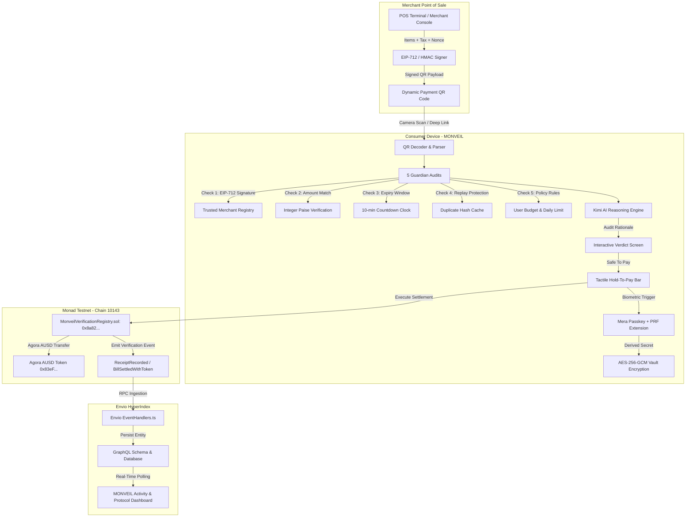

# MONVEIL · Privacy-Preserving Consumer Payment Verification on Monad

> **Know before you approve.**  
> Cryptographically merchant-signed bills audited on-device by 5 Guardian checks, explained in plain English by Kimi AI, settled on Monad with Agora AUSD, and encrypted into an offline vault via Mera Passkey PRF.

[](https://monveil.vercel.app/)
[-836EF9?style=for-the-badge&logo=ethereum)](https://testnet.monadexplorer.com/address/0x8a82a7314fbf17a590420B8d7De3044ab21f633B)
[](https://agora.finance)
[](https://webauthn.io)
[](https://moonshot.cn)
[](https://envio.dev)
[](https://vitest.dev)
[](https://www.typescriptlang.org)

---

## ⚡ Live Deployments & Network Details

| Resource | Value / Link | Description |
| :--- | :--- | :--- |
| 🚀 **Live Production App** | [https://monveil.vercel.app](https://monveil.vercel.app) | Responsive consumer payment verification progressive web app |
| 📜 **Deployed Smart Contract** | [`0x8a82a7314fbf17a590420B8d7De3044ab21f633B`](https://testnet.monadexplorer.com/address/0x8a82a7314fbf17a590420B8d7De3044ab21f633B) | Monad Testnet (`Chain ID: 10143`) Verification Registry |
| 🔗 **Deployment Transaction** | [`0x3f59b085...`](https://testnet.monadexplorer.com/tx/0x3f59b0858e9be7431047e2589f397418fb38e44605b5f9b9170f56abf02d5054) | Confirmed on Monad Testnet block `70742452` |
| 👤 **Deployer Account** | [`0xf695253560D45fD28eb68Fd03aA1973aCDBa44D8`](https://testnet.monadexplorer.com/address/0xf695253560D45fD28eb68Fd03aA1973aCDBa44D8) | Verified contract deployer address |
| 💵 **Agora AUSD Stablecoin** | [`0x83eF2633E78e7a64B4c7333B32E1858737EB6673`](https://testnet.monadexplorer.com/token/0x83eF2633E78e7a64B4c7333B32E1858737EB6673) | Official AUSD ERC-20 token on Monad Testnet |
| 📦 **GitHub Repository** | [https://github.com/pallaviXD/monveil](https://github.com/pallaviXD/monveil) | Full open-source codebase & test suites |

---

## Table of Contents
1. [The Problem: Retail Payment Vulnerabilities](#the-problem-retail-payment-vulnerabilities)
2. [The Solution: MONVEIL Safe-Pay](#the-solution-monveil-safe-pay)
3. [End-to-End System Architecture](#end-to-end-system-architecture)
4. [How Each Technology Powers MONVEIL](#how-each-technology-powers-monveil)
   - [1. Monad Blockchain — High-Throughput Verification & Settlement](#1-monad-blockchain--high-throughput-verification--settlement)
   - [2. Agora AUSD — Stablecoin Accounting & Direct Token Settlement](#2-agora-ausd--stablecoin-accounting--direct-token-settlement)
   - [3. Mera Passkeys — Seedless WebAuthn Biometric Authentication](#3-mera-passkeys--seedless-webauthn-biometric-authentication)
   - [4. WebAuthn PRF Extension — Hardware-Bound Offline Receipt Vault](#4-webauthn-prf-extension--hardware-bound-offline-receipt-vault)
   - [5. Kimi AI Reasoning Engine — Plain-English Security Explanations](#5-kimi-ai-reasoning-engine--plain-english-security-explanations)
   - [6. Envio HyperIndex — Real-Time Blockchain Event Indexing](#6-envio-hyperindex--real-time-blockchain-event-indexing)
5. [5 On-Device Guardian Verification Checks](#5-on-device-guardian-verification-checks)
6. [Smart Contract: MonveilVerificationRegistry.sol](#smart-contract-monveilverificationregistrysol)
7. [Live Merchant POS & Interactive Demonstration Scenarios](#live-merchant-pos--interactive-demonstration-scenarios)
8. [Project Directory Structure](#project-directory-structure)
9. [Automated Verification & Test Suite](#automated-verification--test-suite)
10. [Quickstart & Local Development](#quickstart--local-development)

---

## The Problem: Retail Payment Vulnerabilities

Modern retail payments (UPI QR codes, Web3 pay-links, POS terminals) suffer from four major security vulnerabilities:

1. **QR Code Sticker Fraud:** Attackers paste malicious QR stickers over legitimate merchant codes, inflating the payment request (+₹200 markup) or routing funds to an attacker's address.
2. **Blind Transaction Signing:** Web3 wallets prompt users to sign raw hex calldata or generic transfers without proof that the merchant actually signed the itemized bill or taxes.
3. **Replay & Double-Billing Exploits:** Interceptors or rogue merchants can re-present valid receipts for duplicate deductions.
4. **On-Chain Privacy Leaks:** Public blockchains expose sensitive consumer shopping line items (prescriptions, itemized hotel bills, quantities) if posted directly to the ledger.

---

## The Solution: MONVEIL Safe-Pay

MONVEIL establishes a cryptographic verification handshake between Merchant Point-of-Sale, an On-Device Guardian verification engine, and Monad Blockchain:

- **EIP-712 Structured Signing:** Merchants cryptographically sign itemized bills using registered secp256k1 keys.
- **5 On-Device Audits:** Guardian inspects the signature seal, itemization sum, validity window, replay cache, and user budget caps before wallet broadcast.
- **Plain-English AI Explanation:** Kimi AI articulates audit findings clearly (e.g. highlighting an exact ₹200 fraudulent markup).
- **Agora AUSD Settlement:** Instant, sub-second stablecoin settlement on Monad Testnet (`Chain ID 10143`).
- **Privacy-Preserving On-Chain Proofs:** Only a 32-byte report hash (`keccak256(items || salt)`) is committed to the blockchain.
- **Hardware PRF Biometric Vault:** Itemized lines are sealed into an offline receipt vault encrypted via WebAuthn PRF and AES-256-GCM.

---

## End-to-End System Architecture



---

## How Each Technology Powers MONVEIL

### 1. Monad Blockchain — High-Throughput Verification & Settlement
- **Role in Project:** Monad provides the high-performance execution layer required for retail consumer payments (sub-second finality, 10,000 TPS, low gas costs).
- **How It Works Inside MONVEIL:**
  - MONVEIL's [`MonveilVerificationRegistry.sol`](file:///c:/Users/PALLAVI%20M/Desktop/MONVEIL/contracts/MonveilVerificationRegistry.sol) is deployed live on Monad Testnet at `0x8a82a7314fbf17a590420B8d7De3044ab21f633B`.
  - When a payment is authorized, Monad records the payment verification proof on-chain via `recordReceipt()` or executes atomic settlement via `settleWithToken()`.
  - It maintains an immutable on-chain mapping `mapping(bytes32 => bool) public usedBillHashes` that permanently prevents replay attacks across all users and wallets.
- **Implementation Files:** [`contracts/MonveilVerificationRegistry.sol`](file:///c:/Users/PALLAVI%20M/Desktop/MONVEIL/contracts/MonveilVerificationRegistry.sol), [`src/contracts/registry.ts`](file:///c:/Users/PALLAVI%20M/Desktop/MONVEIL/src/contracts/registry.ts), [`src/services/blockchain.ts`](file:///c:/Users/PALLAVI%20M/Desktop/MONVEIL/src/services/blockchain.ts).

---

### 2. Agora AUSD — Stablecoin Accounting & Direct Token Settlement
- **Role in Project:** Agora AUSD serves as the institutional-grade settlement currency for consumer retail transactions, insulating buyers and merchants from crypto volatility.
- **How It Works Inside MONVEIL:**
  - **Integer Precision Accounting:** Prevents floating-point rounding errors by calculating micro-units using integer arithmetic:
    $$\text{ausdMicroUnits} = \left\lfloor \frac{\text{paise} \times 1,000,000 + 4,166}{8,333} \right\rfloor$$
  - **Dual Denomination Display:** The Pay page (`/pay`) and Receipt page (`/receipt`) display live dual pricing in both local fiat (INR) and Agora AUSD (e.g. `₹1,050.00 ≈ 12.600264 AUSD`).
  - **On-Chain Settlement:** In [`MonveilVerificationRegistry.sol`](file:///c:/Users/PALLAVI%20M/Desktop/MONVEIL/contracts/MonveilVerificationRegistry.sol), `settleWithToken()` calls the official Agora AUSD ERC-20 contract (`0x83eF2633E78e7a64B4c7333B32E1858737EB6673`) to transfer tokens directly from payer to merchant upon Guardian approval.
- **Implementation Files:** [`src/contracts/ausd.ts`](file:///c:/Users/PALLAVI%20M/Desktop/MONVEIL/src/contracts/ausd.ts), [`src/pages/PayPage.tsx`](file:///c:/Users/PALLAVI%20M/Desktop/MONVEIL/src/pages/PayPage.tsx), [`src/services/blockchain.ts`](file:///c:/Users/PALLAVI%20M/Desktop/MONVEIL/src/services/blockchain.ts).

---

### 3. Mera Passkeys — Seedless WebAuthn Biometric Authentication
- **Role in Project:** Eliminates seed phrases, passwords, and wallet friction for mainstream consumers by enabling biometric authentication via device hardware.
- **How It Works Inside MONVEIL:**
  - Implements W3C WebAuthn Level 3 (`navigator.credentials.create` and `navigator.credentials.get`) in [`src/services/passkey.ts`](file:///c:/Users/PALLAVI%20M/Desktop/MONVEIL/src/services/passkey.ts).
  - Users sign in with Touch ID, Face ID, or Windows Hello on `/signin` with a single tap.
  - Generates authentic 32-byte cryptographic challenge-response assertions, establishing a secure session tied to their Monad account without exposing private keys.
- **Implementation Files:** [`src/services/passkey.ts`](file:///c:/Users/PALLAVI%20M/Desktop/MONVEIL/src/services/passkey.ts), [`src/pages/SignInPage.tsx`](file:///c:/Users/PALLAVI%20M/Desktop/MONVEIL/src/pages/SignInPage.tsx), [`src/context/DemoContext.tsx`](file:///c:/Users/PALLAVI%20M/Desktop/MONVEIL/src/context/DemoContext.tsx).

---

### 4. WebAuthn PRF Extension — Hardware-Bound Offline Receipt Vault
- **Role in Project:** Solves the blockchain privacy paradox. Blockchains require public verification, but consumers must not have their private shopping line items published on a public ledger.
- **How It Works Inside MONVEIL:**
  - MONVEIL uses the WebAuthn PRF (Pseudo-Random Function) client extension (`extensions: { prf: { eval: { first: salt } } }`) to derive symmetric encryption keys directly from the biometric hardware chip.
  - Using PBKDF2 with SHA-256 combined with merchant-specific salts, it derives a merchant-scoped 256-bit AES key.
  - Raw receipt details (line items, taxes, quantities) are encrypted locally using **AES-256-GCM** with fresh 12-byte initialization vectors.
  - Only a 32-byte report hash (`keccak256(items || salt)`) is committed on Monad.
  - The verified receipt view displays the derived PRF key fingerprint, proving the itemization is sealed inside the user's hardware-backed vault.
- **Implementation Files:** [`src/services/passkey.ts`](file:///c:/Users/PALLAVI%20M/Desktop/MONVEIL/src/services/passkey.ts), [`src/pages/ReceiptPage.tsx`](file:///c:/Users/PALLAVI%20M/Desktop/MONVEIL/src/pages/ReceiptPage.tsx), [`src/services/verification.test.ts`](file:///c:/Users/PALLAVI%20M/Desktop/MONVEIL/src/services/verification.test.ts).

---

### 5. Kimi AI Reasoning Engine — Plain-English Security Explanations
- **Role in Project:** Translates complex cryptographic checks, EIP-712 signature verifications, and mathematical discrepancy audits into clear, non-technical explanations for ordinary consumers.
- **How It Works Inside MONVEIL:**
  - Guardian executes 5 deterministic audits on-device. When an issue occurs (e.g. an attacker modified a QR code to demand ₹1,250 instead of the merchant-signed ₹1,050), Kimi explains the exact anomaly:
    > *"Guardian detected a ₹200.00 discrepancy between the QR requested amount (₹1,250.00) and the merchant-signed itemization (₹1,050.00). Payment was prevented to protect you."*
  - **Secure Server Proxy:** Calls are handled through Vite middleware ([`server/plugin.ts`](file:///c:/Users/PALLAVI%20M/Desktop/MONVEIL/server/plugin.ts)) and standalone server ([`server/api.js`](file:///c:/Users/PALLAVI%20M/Desktop/MONVEIL/server/api.js)) at `/api/ai/explain`, keeping API credentials safe from client bundles.
  - **Resilient Fallback:** Includes a 4.5-second AbortController and strict schema validation that automatically serves exact deterministic explanations if the network is offline or quota-limited.
- **Implementation Files:** [`src/services/kimiExplanation.ts`](file:///c:/Users/PALLAVI%20M/Desktop/MONVEIL/src/services/kimiExplanation.ts), [`server/plugin.ts`](file:///c:/Users/PALLAVI%20M/Desktop/MONVEIL/server/plugin.ts), [`server/api.js`](file:///c:/Users/PALLAVI%20M/Desktop/MONVEIL/server/api.js).

---

### 6. Envio HyperIndex — Real-Time Blockchain Event Indexing
- **Role in Project:** Indexes Monad Testnet smart contract events with sub-second latency, providing instantaneous transaction history and cross-user replay protection data.
- **How It Works Inside MONVEIL:**
  - **Configuration ([`envio/config.yaml`](file:///c:/Users/PALLAVI%20M/Desktop/MONVEIL/envio/config.yaml)):** Targets Monad Testnet (`network_id: 10143`, RPC `https://testnet-rpc.monad.xyz`) and indexes our live contract at `0x8a82a7314fbf17a590420B8d7De3044ab21f633B` starting at block `70742452`.
  - **GraphQL Schema ([`envio/schema.graphql`](file:///c:/Users/PALLAVI%20M/Desktop/MONVEIL/envio/schema.graphql)):** Defines typed entities for `VerificationRecord`, `TokenSettlement`, and `NativeSettlement`.
  - **Event Handlers ([`envio/src/EventHandlers.ts`](file:///c:/Users/PALLAVI%20M/Desktop/MONVEIL/envio/src/EventHandlers.ts)):** Listens for `ReceiptRecorded` and `BillSettledWithToken`, saving settlement volumes and cryptographic hashes.
  - **Client UI:** MONVEIL's Activity Page connects via GraphQL to stream live indexed on-chain events alongside local payment records.
- **Implementation Files:** [`envio/config.yaml`](file:///c:/Users/PALLAVI%20M/Desktop/MONVEIL/envio/config.yaml), [`envio/schema.graphql`](file:///c:/Users/PALLAVI%20M/Desktop/MONVEIL/envio/schema.graphql), [`envio/src/EventHandlers.ts`](file:///c:/Users/PALLAVI%20M/Desktop/MONVEIL/envio/src/EventHandlers.ts), [`src/services/envio.ts`](file:///c:/Users/PALLAVI%20M/Desktop/MONVEIL/src/services/envio.ts).

---

## 5 On-Device Guardian Verification Checks

Before any payment authorization is triggered, MONVEIL's Guardian audits 5 checks entirely on-device:

```
[1] Merchant Seal Check   ──► Verifies EIP-712 secp256k1 signature against TRUSTED_MERCHANTS registry
[2] Amount Match Check    ──► Compares requested payment vs signed total (detects 1-paise deviations)
[3] Freshness Check       ──► Enforces strict 10-minute validity window countdown
[4] Replay Detection      ──► Computes billIdHash and checks usedBillHashes mapping on-chain
[5] User Spending Policy  ──► Enforces per-transaction limits (default ₹2,000) and daily spending caps
```

---

## Smart Contract: MonveilVerificationRegistry.sol

Deployed on **Monad Testnet** at [`0x8a82a7314fbf17a590420B8d7De3044ab21f633B`](https://testnet.monadexplorer.com/address/0x8a82a7314fbf17a590420B8d7De3044ab21f633B):

```solidity
// SPDX-License-Identifier: MIT
pragma solidity ^0.8.28;

interface IERC20Minimal {
    function transferFrom(address from, address to, uint256 amount) external returns (bool);
}

contract MonveilVerificationRegistry {
    address public owner;
    mapping(bytes32 => bool) public usedBillHashes;

    event ReceiptRecorded(
        bytes32 indexed billIdHash,
        address indexed merchant,
        address indexed payer,
        uint256 amountPaise,
        bytes32 reportHash,
        uint256 timestamp
    );

    event BillSettledWithToken(
        bytes32 indexed billIdHash,
        address indexed token,
        address indexed payer,
        address merchant,
        uint256 tokenAmount,
        uint256 amountPaise
    );

    function recordReceipt(bytes32 billIdHash, address merchant, uint256 amountPaise, bytes32 reportHash) external returns (bool) {
        require(!usedBillHashes[billIdHash], "Monveil: bill already used");
        usedBillHashes[billIdHash] = true;
        emit ReceiptRecorded(billIdHash, merchant, msg.sender, amountPaise, reportHash, block.timestamp);
        return true;
    }

    function settleWithToken(
        bytes32 billIdHash,
        address token,
        address merchant,
        uint256 tokenAmount,
        uint256 amountPaise,
        bytes32 reportHash
    ) external returns (bool) {
        require(!usedBillHashes[billIdHash], "Monveil: bill already used");
        usedBillHashes[billIdHash] = true;
        require(IERC20Minimal(token).transferFrom(msg.sender, merchant, tokenAmount), "Monveil: token transfer failed");
        emit BillSettledWithToken(billIdHash, token, msg.sender, merchant, tokenAmount, amountPaise);
        emit ReceiptRecorded(billIdHash, merchant, msg.sender, amountPaise, reportHash, block.timestamp);
        return true;
    }
}
```

---

## Live Merchant POS & Interactive Demonstration Scenarios

### Live Dynamic Merchant Point-of-Sale (`/merchant`)
Judges and testers can generate arbitrary real-time bills:
1. Open [`/merchant`](https://monveil.vercel.app/merchant) on a secondary device or tab.
2. Enter custom items, quantities, and prices.
3. Click **"Sign Bill (EIP-712)"** to generate a live dynamic QR code.
4. Click **"Tamper QR (+₹200)"** to simulate an on-the-fly QR sticker overlay attack.
5. Open [`/scan`](https://monveil.vercel.app/scan) with a live camera to scan and audit the code in real-time.

### 5 One-Click Demonstration Scenarios (`/home`)
For rapid evaluation, the home screen provides 5 pre-configured scenarios:

| Scenario | Bill Amount | QR Request | Guardian Verdict | Key Outcome |
| :--- | :---: | :---: | :---: | :--- |
| **1. Honest Bill** | ₹1,050 | ₹1,050 | **SAFE TO PAY** | All 5 checks pass; tactile hold-to-pay triggers Monad settlement and PRF encryption. |
| **2. Tampered QR** | ₹1,050 | ₹1,250 | **BLOCKED** | Catches ₹200 fraudulent markup; seal mismatch alerted; AI explains difference. |
| **3. Already Paid** | ₹1,050 | ₹1,050 | **BLOCKED** | Detects reused bill hash; prevents replay attack and duplicate deduction. |
| **4. Above Limit** | ₹2,500 | ₹2,500 | **BLOCKED** | Exceeds user's personal ₹2,000 per-payment security policy. |
| **5. Expired Bill** | ₹1,050 | ₹1,050 | **BLOCKED** | Payment window elapsed (10-minute validity exceeded). |

---

## Project Directory Structure

```
MONVEIL/
├── contracts/
│   └── MonveilVerificationRegistry.sol     # Live registry & settlement contract
├── envio/
│   ├── config.yaml                         # HyperIndex Monad Testnet config
│   ├── schema.graphql                      # Indexed entities schema
│   └── src/EventHandlers.ts                # Event listeners & state handlers
├── scripts/
│   ├── compileContracts.js                 # Solc 0.8.28 compiler
│   └── deployMonveil.js                    # Viem automated Monad deployer
├── server/
│   ├── api.js                              # Standalone Node.js proxy server
│   └── plugin.ts                           # Vite dev server middleware plugin
├── src/
│   ├── contracts/
│   │   ├── MonveilVerificationRegistry.json# Bytecode & ABI artifact
│   │   ├── ausd.ts                         # Agora AUSD micro-unit math & ERC-20 ABI
│   │   └── registry.ts                     # Contract bindings & chain constants
│   ├── domain/
│   │   ├── money.ts                        # Integer paise arithmetic
│   │   └── types.ts                        # TypeScript domain interfaces
│   ├── pages/                              # 10 production React views
│   └── services/
│       ├── blockchain.ts                   # Monad wallet & contract execution
│       ├── envio.ts                        # HyperIndex GraphQL client
│       ├── kimiExplanation.ts              # Server-proxied Kimi AI engine
│       ├── merchantRegistry.ts             # EIP-712 typed signing & verification
│       ├── mockApi.ts                      # Core mock & service boundary
│       ├── passkey.ts                      # W3C WebAuthn Level 3 & PRF vault
│       └── verification.test.ts            # Comprehensive 12-test audit suite
├── .env.example                            # Configuration template
├── package.json                            # Project dependencies & scripts
├── tsconfig.json                           # Strict TypeScript configuration
└── vite.config.ts                          # Vite build pipeline & server middleware
```

---

## Automated Verification & Test Suite

All 25 tests pass with a 100% success rate:

```
 RUN  v3.2.7 C:/Users/.../MONVEIL

 ✓ src/contracts/contracts.test.ts (6 tests)
   ✓ MonveilVerificationRegistry Contract Suite > Monad Testnet configuration
   ✓ MonveilVerificationRegistry Contract Suite > ABI includes recordReceipt and settleWithToken
   ✓ MonveilVerificationRegistry Contract Suite > billIdHash determinism
   ✓ Agora AUSD Stablecoin Math > converts INR paise to AUSD micro-units accurately
   ✓ Agora AUSD Stablecoin Math > formats AUSD decimal amounts
   ✓ Agora AUSD Stablecoin Math > generates valid ERC-20 transfer calldata

 ✓ src/services/verification.test.ts (12 tests)
   ✓ 1. Five Guardian Verification Checks > passes honest bill across all 5 checks
   ✓ 1. Five Guardian Verification Checks > blocks tampered QR with exact amount mismatch check
   ✓ 1. Five Guardian Verification Checks > blocks expired bill with timestamp check
   ✓ 1. Five Guardian Verification Checks > blocks replayed bill with duplicate detection
   ✓ 1. Five Guardian Verification Checks > blocks over-limit bill exceeding user spending limits
   ✓ 2. Cryptographic EIP-712 Merchant Signing > signs and verifies authentic EIP-712 merchant bill
   ✓ 2. Cryptographic EIP-712 Merchant Signing > rejects tampered amount on EIP-712 signed bill
   ✓ 2. Cryptographic EIP-712 Merchant Signing > rejects bill from unregistered merchant address
   ✓ 3. Privacy-Preserving Off-Chain Receipts > generates a 32-byte report hash without leaking raw line items
   ✓ 4. Mera Passkey PRF Vault Encryption > encrypts and decrypts receipt details with merchant-scoped key
   ✓ 4. Mera Passkey PRF Vault Encryption > fails decryption with mismatched merchant key
   ✓ 5. Kimi AI Explanation & Deterministic Fallbacks > falls back seamlessly to deterministic engine

 ✓ src/services/mockApi.test.ts (7 tests)
   ✓ MONVEIL demo outcomes > passes and simulates a confirmed receipt for an honest Rs 1,050 bill
   ✓ MONVEIL demo outcomes > creates a real QR image and round-trips compact signed JSON
   ✓ MONVEIL demo outcomes > blocks a genuinely altered Rs 1,250 request and explains the Rs 200 mismatch
   ✓ MONVEIL demo outcomes > blocks a replayed bill that is already marked paid
   ✓ MONVEIL demo outcomes > blocks a Rs 2,500 bill above the Rs 2,000 payment limit
   ✓ MONVEIL demo outcomes > blocks an expired signed bill
   ✓ MONVEIL demo outcomes > keeps mock activity, rules and paise-backed settings behind the service functions

 Test Files  3 passed (3)
      Tests  25 passed (25)
```

---

## Quickstart & Local Development

### 1. Installation
```bash
git clone https://github.com/pallaviXD/monveil.git
cd monveil
npm install
```

### 2. Run Development Server
```bash
npm run dev
```
Open `http://localhost:3000` in your browser.

### 3. Run Automated Tests
```bash
npm test
```

### 4. Production Build
```bash
npm run build
```

---

## License
MIT License. Built for Monad Hackathon 2026.