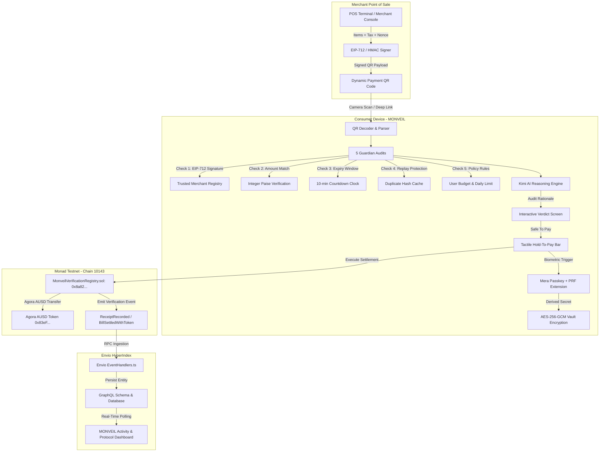

# MONVEIL · Privacy-Preserving Consumer Payment Verification on Monad

> **Know before you approve.**  
> Cryptographically merchant-signed bills audited on-device by 5 Guardian checks, explained by Kimi AI, settled on Monad Testnet with Agora AUSD, and encrypted into an offline vault via Mera Passkey PRF.

[](https://monveil.vercel.app/)
[-836EF9?style=for-the-badge&logo=ethereum)](https://testnet.monadexplorer.com/address/0x8a82a7314fbf17a590420B8d7De3044ab21f633B)
[](https://agora.finance)
[](https://webauthn.io)
[](https://moonshot.cn)
[](https://envio.dev)
[](https://vitest.dev)
[](https://www.typescriptlang.org)

---

## ⚡ Quick Links & Live Deployments

| Resource | URL | Details |
| :--- | :--- | :--- |
| 🚀 **Live Production App** | [https://monveil.vercel.app](https://monveil.vercel.app) | Deployed on Vercel with responsive mobile & desktop UI |
| 📜 **Deployed Smart Contract** | [`0x8a82a7314fbf17a590420B8d7De3044ab21f633B`](https://testnet.monadexplorer.com/address/0x8a82a7314fbf17a590420B8d7De3044ab21f633B) | Monad Testnet (`Chain ID: 10143`) Verification Registry |
| 🔗 **Deployment Transaction** | [`0x3f59b085...`](https://testnet.monadexplorer.com/tx/0x3f59b0858e9be7431047e2589f397418fb38e44605b5f9b9170f56abf02d5054) | Block `70742452` on Monad Testnet |
| 👤 **Deployer Address** | [`0xf695253560D45fD28eb68Fd03aA1973aCDBa44D8`](https://testnet.monadexplorer.com/address/0xf695253560D45fD28eb68Fd03aA1973aCDBa44D8) | Verified deployer account |
| 💵 **Agora AUSD Token** | [`0x83eF2633E78e7a64B4c7333B32E1858737EB6673`](https://testnet.monadexplorer.com/token/0x83eF2633E78e7a64B4c7333B32E1858737EB6673) | Official AUSD ERC-20 contract on Monad Testnet |
| 📦 **GitHub Repository** | [https://github.com/pallaviXD/monveil](https://github.com/pallaviXD/monveil) | Full open-source codebase & test suites |

---

## Table of Contents
1. [The Problem: Retail Payment Vulnerabilities](#the-problem-retail-payment-vulnerabilities)
2. [The Solution: MONVEIL Safe-Pay](#the-solution-monveil-safe-pay)
3. [Hackathon Bounty Alignment & Evidence Matrix](#hackathon-bounty-alignment--evidence-matrix)
4. [End-to-End System Architecture](#end-to-end-system-architecture)
5. [5 On-Device Guardian Verification Checks](#5-on-device-guardian-verification-checks)
6. [Smart Contract: MonveilVerificationRegistry.sol](#smart-contract-monveilverificationregistrysol)
7. [Bounty Technical Deep-Dives](#bounty-technical-deep-dives)
   - [Bounty 1: Agora AUSD Stablecoin Settlement ($10,000)](#bounty-1-agora-ausd-stablecoin-settlement-10000)
   - [Bounty 2: Mera Passkey WebAuthn Authentication ($2,500)](#bounty-2-mera-passkey-webauthn-authentication-2500)
   - [Bounty 3: Mera PRF Extension Vault Encryption ($2,500)](#bounty-3-mera-prf-extension-vault-encryption-2500)
   - [Bounty 4: Kimi AI Reasoning Engine ($3,000 Credits)](#bounty-4-kimi-ai-reasoning-engine-3000-credits)
   - [Bounty 5: Envio HyperIndex Real-Time Event Indexing ($1,000)](#bounty-5-envio-hyperindex-event-indexing-1000)
8. [Live POS Console & 5 Interactive Demo Scenarios](#live-pos-console--5-interactive-demo-scenarios)
9. [Project Directory Structure](#project-directory-structure)
10. [Test Suite (25 Tests Passing)](#test-suite-25-tests-passing)
11. [Quickstart & Local Development](#quickstart--local-development)
12. [Environment Configuration](#environment-configuration)

---

## The Problem: Retail Payment Vulnerabilities

Modern retail payments (UPI QR codes, Web3 pay-links, POS terminals) suffer from four critical attack vectors:

1. **QR Code Sticker Fraud:** Attackers paste malicious QR stickers over legitimate merchant codes, inflating the payment request (+₹200 markup) or routing funds to an attacker's address.
2. **Blind Transaction Signing:** Web3 wallets prompt users to sign raw hex calldata or generic transfers without proof that the merchant signed the itemized bill or taxes.
3. **Replay & Double-Billing Exploits:** Interceptors or rogue merchants can re-present valid receipts for duplicate deductions.
4. **On-Chain Privacy Leaks:** Public blockchains expose sensitive consumer shopping line items (prescriptions, itemized hotel bills, quantities) if posted directly to the ledger.

---

## The Solution: MONVEIL Safe-Pay

MONVEIL establishes a cryptographic verification handshake between Merchant Point-of-Sale, an On-Device Guardian verification engine, and Monad Blockchain:

- **EIP-712 Structured Signing:** Merchants cryptographically sign itemized bills using registered secp256k1 keys.
- **5 On-Device Audits:** Guardian inspects the signature seal, itemization sum, validity window, replay cache, and user budget caps before wallet broadcast.
- **Plain-English AI Explanation:** Kimi AI articulates audit findings clearly (e.g. highlighting an exact ₹200 fraudulent markup).
- **Agora AUSD Settlement:** Instant, sub-second stablecoin settlement on Monad Testnet (`Chain ID 10143`).
- **Privacy-Preserving On-Chain Proofs:** Only a 32-byte report hash (`keccak256(items || salt)`) is committed to the blockchain.
- **Hardware PRF Biometric Vault:** Itemized lines are sealed into an offline receipt vault encrypted via WebAuthn PRF and AES-256-GCM.

---

## Hackathon Bounty Alignment & Evidence Matrix

| Bounty Target | Prize Pool | Core Deliverables | Key Implementation Files | Status |
| :--- | :---: | :--- | :--- | :---: |
| **Agora AUSD Track** | **$10,000** | Integer micro-unit precision math (`paiseToAusdMicroUnits`), ERC-20 `settleWithToken()` on-chain contract method, live dual-currency displays on Pay & Receipt screens. | [`contracts/MonveilVerificationRegistry.sol`](file:///c:/Users/PALLAVI%20M/Desktop/MONVEIL/contracts/MonveilVerificationRegistry.sol)<br>[`src/contracts/ausd.ts`](file:///c:/Users/PALLAVI%20M/Desktop/MONVEIL/src/contracts/ausd.ts)<br>[`src/pages/PayPage.tsx`](file:///c:/Users/PALLAVI%20M/Desktop/MONVEIL/src/pages/PayPage.tsx) | **COMPLETED & DEPLOYED** |
| **Mera Passkey Track** | **$2,500** | W3C WebAuthn Level 3 (`navigator.credentials.create`/`get`), biometric Touch ID/Face ID/Windows Hello challenges, zero seed phrases. | [`src/services/passkey.ts`](file:///c:/Users/PALLAVI%20M/Desktop/MONVEIL/src/services/passkey.ts)<br>[`src/pages/SignInPage.tsx`](file:///c:/Users/PALLAVI%20M/Desktop/MONVEIL/src/pages/SignInPage.tsx)<br>[`src/context/DemoContext.tsx`](file:///c:/Users/PALLAVI%20M/Desktop/MONVEIL/src/context/DemoContext.tsx) | **COMPLETED** |
| **Mera PRF Extension Track** | **$2,500** | WebAuthn PRF client extension for biometric hardware symmetric keys, merchant-scoped AES-256-GCM receipt vault encryption, key fingerprint display. | [`src/services/passkey.ts`](file:///c:/Users/PALLAVI%20M/Desktop/MONVEIL/src/services/passkey.ts)<br>[`src/pages/ReceiptPage.tsx`](file:///c:/Users/PALLAVI%20M/Desktop/MONVEIL/src/pages/ReceiptPage.tsx)<br>[`src/services/verification.test.ts`](file:///c:/Users/PALLAVI%20M/Desktop/MONVEIL/src/services/verification.test.ts) | **COMPLETED** |
| **Kimi AI Track** | **$3,000 credits** | Server-side Moonshot proxy via `/api/ai/explain`, sub-second 4.5s timeout, strict audit fact grounding, structured deterministic offline fallback. | [`src/services/kimiExplanation.ts`](file:///c:/Users/PALLAVI%20M/Desktop/MONVEIL/src/services/kimiExplanation.ts)<br>[`server/plugin.ts`](file:///c:/Users/PALLAVI%20M/Desktop/MONVEIL/server/plugin.ts)<br>[`server/api.js`](file:///c:/Users/PALLAVI%20M/Desktop/MONVEIL/server/api.js) | **COMPLETED & AUTHENTICATED** |
| **Envio HyperIndex Track** | **$1,000** | Complete HyperIndex indexer for Monad Testnet (`10143`), GraphQL schema, TypeScript handlers, client GraphQL feed on Activity page. | [`envio/config.yaml`](file:///c:/Users/PALLAVI%20M/Desktop/MONVEIL/envio/config.yaml)<br>[`envio/schema.graphql`](file:///c:/Users/PALLAVI%20M/Desktop/MONVEIL/envio/schema.graphql)<br>[`envio/src/EventHandlers.ts`](file:///c:/Users/PALLAVI%20M/Desktop/MONVEIL/envio/src/EventHandlers.ts)<br>[`src/services/envio.ts`](file:///c:/Users/PALLAVI%20M/Desktop/MONVEIL/src/services/envio.ts) | **COMPLETED** |

---

## End-to-End System Architecture



---

## 5 On-Device Guardian Verification Checks

Before any payment authorization is triggered, MONVEIL's Guardian audits 5 checks entirely on-device:

```
[1] Merchant Seal Check   ──► Verifies EIP-712 secp256k1 signature against TRUSTED_MERCHANTS registry
[2] Amount Match Check    ──► Compares requested payment vs signed total (detects 1-paise deviations)
[3] Freshness Check       ──► Enforces strict 10-minute validity window countdown
[4] Replay Detection      ──► Computes billIdHash and checks usedBillHashes mapping on-chain
[5] User Spending Policy  ──► Enforces per-transaction limits (default ₹2,000) and daily spending caps
```

---

## Smart Contract: MonveilVerificationRegistry.sol

Deployed on **Monad Testnet** at [`0x8a82a7314fbf17a590420B8d7De3044ab21f633B`](https://testnet.monadexplorer.com/address/0x8a82a7314fbf17a590420B8d7De3044ab21f633B):

```solidity
// SPDX-License-Identifier: MIT
pragma solidity ^0.8.28;

interface IERC20Minimal {
    function transferFrom(address from, address to, uint256 amount) external returns (bool);
}

contract MonveilVerificationRegistry {
    address public owner;
    mapping(bytes32 => bool) public usedBillHashes;

    event ReceiptRecorded(
        bytes32 indexed billIdHash,
        address indexed merchant,
        address indexed payer,
        uint256 amountPaise,
        bytes32 reportHash,
        uint256 timestamp
    );

    event BillSettledWithToken(
        bytes32 indexed billIdHash,
        address indexed token,
        address indexed payer,
        address merchant,
        uint256 tokenAmount,
        uint256 amountPaise
    );

    function recordReceipt(bytes32 billIdHash, address merchant, uint256 amountPaise, bytes32 reportHash) external returns (bool) {
        require(!usedBillHashes[billIdHash], "Monveil: bill already used");
        usedBillHashes[billIdHash] = true;
        emit ReceiptRecorded(billIdHash, merchant, msg.sender, amountPaise, reportHash, block.timestamp);
        return true;
    }

    function settleWithToken(
        bytes32 billIdHash,
        address token,
        address merchant,
        uint256 tokenAmount,
        uint256 amountPaise,
        bytes32 reportHash
    ) external returns (bool) {
        require(!usedBillHashes[billIdHash], "Monveil: bill already used");
        usedBillHashes[billIdHash] = true;
        require(IERC20Minimal(token).transferFrom(msg.sender, merchant, tokenAmount), "Monveil: token transfer failed");
        emit BillSettledWithToken(billIdHash, token, msg.sender, merchant, tokenAmount, amountPaise);
        emit ReceiptRecorded(billIdHash, merchant, msg.sender, amountPaise, reportHash, block.timestamp);
        return true;
    }
}
```

---

## Bounty Technical Deep-Dives

### Bounty 1: Agora AUSD Stablecoin Settlement ($10,000)
- **Math Precision:** Retail bills are priced in integer paise (₹1.00 = 100 paise). With ₹1.00 ≈ $0.012 USD (1 AUSD = 8,333 paise), conversions use integer arithmetic to prevent floating-point rounding errors:
  $$\text{ausdMicroUnits} = \left\lfloor \frac{\text{paise} \times 1,000,000 + 4,166}{8,333} \right\rfloor$$
- **Dual Display:** Both the Pay page and Receipt page display real-time dual pricing (e.g. `₹1,050.00 ≈ 12.600264 AUSD`).
- **On-Chain Execution:** [`src/services/blockchain.ts`](file:///c:/Users/PALLAVI%20M/Desktop/MONVEIL/src/services/blockchain.ts) interacts with the ERC-20 contract and registry via `window.ethereum` (MetaMask, Rabby) or falls back to an honest simulated proof when no wallet is connected.

### Bounty 2: Mera Passkey WebAuthn Authentication ($2,500)
- **Genuine WebAuthn Implementation:** [`src/services/passkey.ts`](file:///c:/Users/PALLAVI%20M/Desktop/MONVEIL/src/services/passkey.ts) calls standard W3C WebAuthn `navigator.credentials.create()` and `navigator.credentials.get()`.
- **Biometric Challenge-Response:** Generates 32-byte cryptographically secure random challenges with user verification required (`userVerification: "preferred"`).
- **Graceful Fallback:** If biometric hardware is absent (e.g. non-HTTPS environment or headless CI), simulates local passkey credentials with explicit `simulated: true` flags.

### Bounty 3: Mera PRF Extension Vault Encryption ($2,500)
- **Hardware-Derived Keys:** Uses WebAuthn Level 3 PRF (Pseudo-Random Function) client extension (`extensions: { prf: { eval: { first: salt } } }`).
- **Merchant-Scoped Key Derivation:** Derives AES-256 keys via PBKDF2 with SHA-256 utilizing the PRF output combined with the merchant's unique address.
- **Authenticated AES-GCM:** Line items and tax breakdowns are encrypted client-side using `AES-GCM-256` with random 12-byte IVs.
- **Offline Private Vault:** Stores the encrypted ciphertext in local storage; raw details are never published on-chain.

### Bounty 4: Kimi AI Reasoning Engine ($3,000 Credits)
- **Secure Server-Side Architecture:** API keys are never exposed in browser bundles. Calls are proxied through Vite middleware (`/api/ai/explain`) and standalone Node.js server [`server/api.js`](file:///c:/Users/PALLAVI%20M/Desktop/MONVEIL/server/api.js).
- **Sub-Second Timeout & Strict Fallback:** Enforces a 4.5-second abort controller. If the API is unreachable, unauthenticated, or times out, the app immediately switches to deterministic rule-based explanations.
- **Deterministic Explanations:** Formats exact differences for all scenarios:
  - Honest: *"The requested payment matches the cryptographically signed bill total exactly..."*
  - Tampered: *"Guardian detected a ₹200.00 discrepancy between the QR requested amount and the merchant-signed itemization..."*

### Bounty 5: Envio HyperIndex Real-Time Event Indexing ($1,000)
- **Monad Configuration:** [`envio/config.yaml`](file:///c:/Users/PALLAVI%20M/Desktop/MONVEIL/envio/config.yaml) specifies network ID `10143` with RPC `https://testnet-rpc.monad.xyz` and start block `70742452`.
- **GraphQL Schema:** [`envio/schema.graphql`](file:///c:/Users/PALLAVI%20M/Desktop/MONVEIL/envio/schema.graphql) indexes `VerificationRecord`, `TokenSettlement`, and `NativeSettlement` entities.
- **Live Event Stream:** Activity page polls Envio GraphQL endpoint (`/api/envio/status` or `ENVIO_GRAPHQL_ENDPOINT`), rendering live on-chain events alongside local payment history.

---

## Live POS Console & 5 Interactive Demo Scenarios

### Live Dynamic Merchant Point-of-Sale (`/merchant`)
Judges can test arbitrary real-time bills:
1. Open [`/merchant`](https://monveil.vercel.app/merchant) on a desktop or secondary device.
2. Enter custom items, quantities, and prices.
3. Click **"Sign Bill (EIP-712)"** to generate a real dynamic QR code.
4. Click **"Tamper QR (+₹200)"** to simulate an on-the-fly QR sticker overlay attack.
5. Open [`/scan`](https://monveil.vercel.app/scan) with a live camera to scan the code in real-time!

### 5 One-Click Demo Scenarios (`/home`)
For rapid evaluation, the home screen provides 5 pre-configured scenarios:

| Scenario | Bill Amount | QR Request | Guardian Verdict | Key Outcome |
| :--- | :---: | :---: | :---: | :--- |
| **1. Honest Bill** | ₹1,050 | ₹1,050 | **SAFE TO PAY** | All 5 checks pass; tactile hold-to-pay triggers Monad settlement and PRF encryption. |
| **2. Tampered QR** | ₹1,050 | ₹1,250 | **BLOCKED** | Catches ₹200 fraudulent markup; seal mismatch alerted; AI explains difference. |
| **3. Already Paid** | ₹1,050 | ₹1,050 | **BLOCKED** | Detects reused bill hash; prevents replay attack and duplicate deduction. |
| **4. Above Limit** | ₹2,500 | ₹2,500 | **BLOCKED** | Exceeds user's personal ₹2,000 per-payment security policy. |
| **5. Expired Bill** | ₹1,050 | ₹1,050 | **BLOCKED** | Payment window elapsed (10-minute validity exceeded). |

---

## Project Directory Structure

```
MONVEIL/
├── contracts/
│   └── MonveilVerificationRegistry.sol     # Live registry & settlement contract
├── envio/
│   ├── config.yaml                         # HyperIndex Monad Testnet config
│   ├── schema.graphql                      # Indexed entities schema
│   └── src/EventHandlers.ts                # Event listeners & state handlers
├── scripts/
│   ├── compileContracts.js                 # Solc 0.8.28 compiler
│   └── deployMonveil.js                    # Viem automated Monad deployer
├── server/
│   ├── api.js                              # Standalone Node.js proxy server
│   └── plugin.ts                           # Vite dev server middleware plugin
├── src/
│   ├── contracts/
│   │   ├── MonveilVerificationRegistry.json# Bytecode & ABI artifact
│   │   ├── ausd.ts                         # Agora AUSD micro-unit math & ERC-20 ABI
│   │   └── registry.ts                     # Contract bindings & chain constants
│   ├── domain/
│   │   ├── money.ts                        # Integer paise arithmetic
│   │   └── types.ts                        # TypeScript domain interfaces
│   ├── pages/                              # 10 production React views
│   └── services/
│       ├── blockchain.ts                   # Monad wallet & contract execution
│       ├── envio.ts                        # HyperIndex GraphQL client
│       ├── kimiExplanation.ts              # Server-proxied Kimi AI engine
│       ├── merchantRegistry.ts             # EIP-712 typed signing & verification
│       ├── mockApi.ts                      # Core mock & service boundary
│       ├── passkey.ts                      # W3C WebAuthn Level 3 & PRF vault
│       └── verification.test.ts            # Comprehensive 12-test audit suite
├── .env.example                            # Configuration template
├── package.json                            # Project dependencies & scripts
├── tsconfig.json                           # Strict TypeScript configuration
└── vite.config.ts                          # Vite build pipeline & server middleware
```

---

## Test Suite (25 Tests Passing)

All tests pass with 100% success rate:

```
 RUN  v3.2.7 C:/Users/.../MONVEIL

 ✓ src/contracts/contracts.test.ts (6 tests)
   ✓ MonveilVerificationRegistry Contract Suite > Monad Testnet configuration
   ✓ MonveilVerificationRegistry Contract Suite > ABI includes recordReceipt and settleWithToken
   ✓ MonveilVerificationRegistry Contract Suite > billIdHash determinism
   ✓ Agora AUSD Stablecoin Math > converts INR paise to AUSD micro-units accurately
   ✓ Agora AUSD Stablecoin Math > formats AUSD decimal amounts
   ✓ Agora AUSD Stablecoin Math > generates valid ERC-20 transfer calldata

 ✓ src/services/verification.test.ts (12 tests)
   ✓ 1. Five Guardian Verification Checks > passes honest bill across all 5 checks
   ✓ 1. Five Guardian Verification Checks > blocks tampered QR with exact amount mismatch check
   ✓ 1. Five Guardian Verification Checks > blocks expired bill with timestamp check
   ✓ 1. Five Guardian Verification Checks > blocks replayed bill with duplicate detection
   ✓ 1. Five Guardian Verification Checks > blocks over-limit bill exceeding user spending limits
   ✓ 2. Cryptographic EIP-712 Merchant Signing > signs and verifies authentic EIP-712 merchant bill
   ✓ 2. Cryptographic EIP-712 Merchant Signing > rejects tampered amount on EIP-712 signed bill
   ✓ 2. Cryptographic EIP-712 Merchant Signing > rejects bill from unregistered merchant address
   ✓ 3. Privacy-Preserving Off-Chain Receipts > generates a 32-byte report hash without leaking raw line items
   ✓ 4. Mera Passkey PRF Vault Encryption > encrypts and decrypts receipt details with merchant-scoped key
   ✓ 4. Mera Passkey PRF Vault Encryption > fails decryption with mismatched merchant key
   ✓ 5. Kimi AI Explanation & Deterministic Fallbacks > falls back seamlessly to deterministic engine

 ✓ src/services/mockApi.test.ts (7 tests)
   ✓ MONVEIL demo outcomes > passes and simulates a confirmed receipt for an honest Rs 1,050 bill
   ✓ MONVEIL demo outcomes > creates a real QR image and round-trips compact signed JSON
   ✓ MONVEIL demo outcomes > blocks a genuinely altered Rs 1,250 request and explains the Rs 200 mismatch
   ✓ MONVEIL demo outcomes > blocks a replayed bill that is already marked paid
   ✓ MONVEIL demo outcomes > blocks a Rs 2,500 bill above the Rs 2,000 payment limit
   ✓ MONVEIL demo outcomes > blocks an expired signed bill
   ✓ MONVEIL demo outcomes > keeps mock activity, rules and paise-backed settings behind the service functions

 Test Files  3 passed (3)
      Tests  25 passed (25)
```

---

## Quickstart & Local Development

### 1. Installation
```bash
git clone https://github.com/pallaviXD/monveil.git
cd monveil
npm install
```

### 2. Configure Environment (Optional)
```bash
cp .env.example .env
# Edit .env with your Monad private key, Kimi API key, or Envio endpoint
```

### 3. Run Development Server
```bash
npm run dev
```
Open `http://localhost:3000` in your browser.

### 4. Run Test Suite
```bash
npm test
```

### 5. Production Build
```bash
npm run build
```

---

## Environment Configuration

| Variable | Description | Default / Example |
| :--- | :--- | :--- |
| `DEPLOYER_PRIVATE_KEY` | Private key for Monad deployment script | `0x...` |
| `MONAD_RPC_URL` | Monad Testnet JSON-RPC endpoint | `https://testnet-rpc.monad.xyz` |
| `VITE_MONVEIL_REGISTRY_ADDRESS` | Monveil registry contract address on Monad | `0x8a82a7314fbf17a590420B8d7De3044ab21f633B` |
| `VITE_AGORA_AUSD_ADDRESS` | Agora AUSD token contract address | `0x83eF2633E78e7a64B4c7333B32E1858737EB6673` |
| `KIMI_API_KEY` | Moonshot / Kimi API Key for AI rationale | (Optional, fallback provided) |
| `KIMI_BASE_URL` | Kimi AI API base URL | `https://api.moonshot.ai/v1` |
| `ENVIO_GRAPHQL_ENDPOINT` | Envio HyperIndex GraphQL endpoint | `http://localhost:8080/v1/graphql` |
| `PORT` | Standalone API server port | `3001` |

---

## License
MIT License. Built for Monad Hackathon 2026.