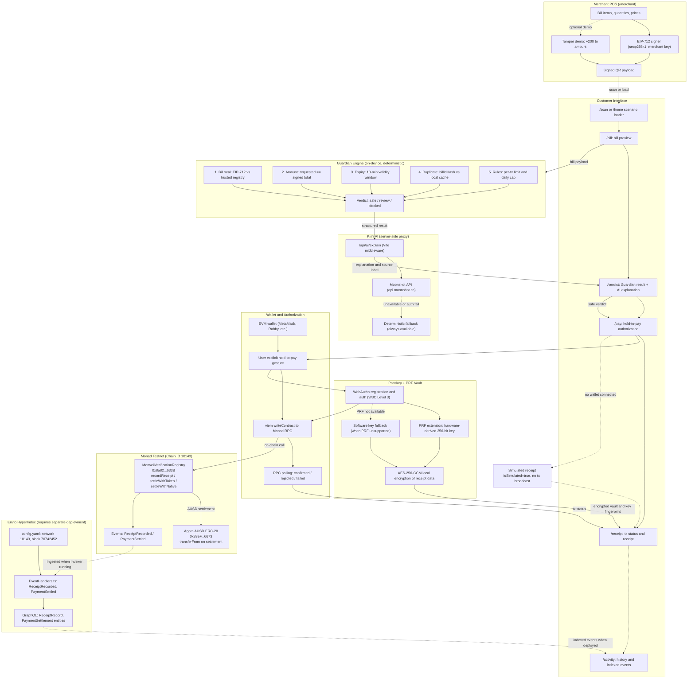
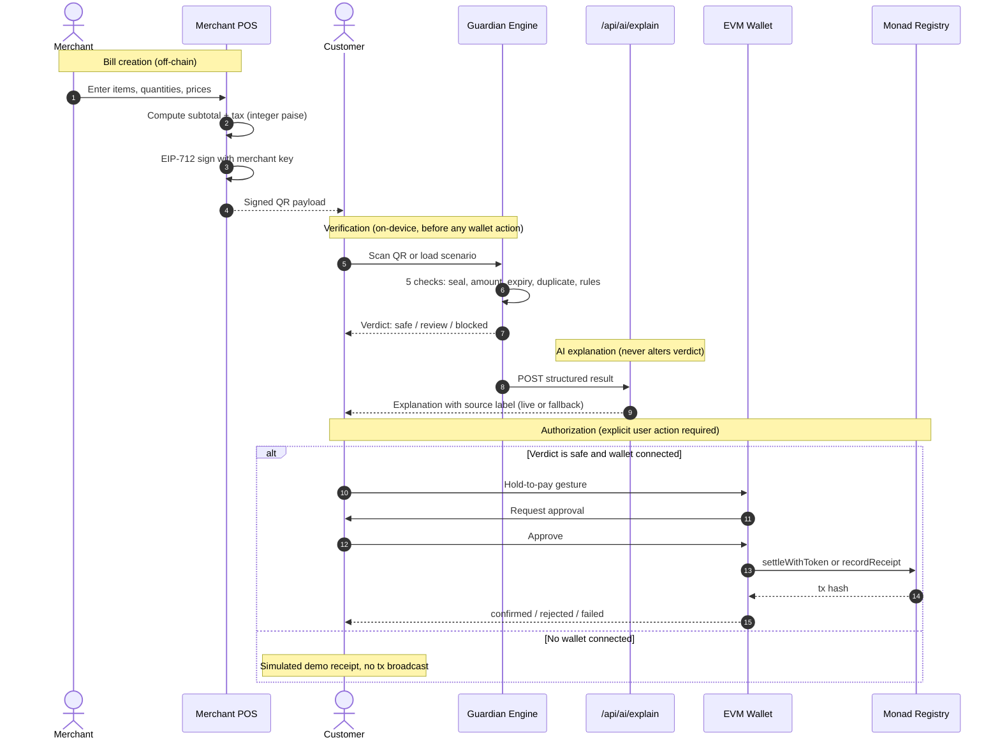

# Monveil
### Know before you approve.

Monveil is an evidence-first payment verification and risk-reduction layer for stablecoin payments on Monad. Before a user authorizes a payment, Monveil checks the available evidence behind the request and helps them understand exactly what they are approving.

It is not a wallet replacement. It is the step between receiving a payment request and deciding whether to act on it.

[](https://monveil.vercel.app/)
[](https://testnet.monadexplorer.com/address/0x8a82a7314fbf17a590420B8d7De3044ab21f633B)
[](https://vitest.dev)
[](https://www.typescriptlang.org)

---

## The Problem

A merchant hands you an invoice for a coffee and a meal: two line items, a total of 2,000 rupees. You scan the QR code on the receipt. Your wallet shows an amount and a destination address and asks you to approve.

What the wallet cannot tell you from those details alone:

- Whether the requested amount matches the itemized invoice the merchant printed
- Whether the request was signed by the actual merchant key or generated by someone who swapped the QR sticker
- Whether this exact request was already used to collect a payment five minutes ago
- Whether the request is still within its intended validity window

The gap between what you intend to pay and what the payment request is actually asking for is where fraud lives. Monveil closes that gap by checking the available evidence before any wallet action takes place.

---

## The Solution

Monveil establishes a verification step that sits between the payment request and the wallet approval:

**Guardian evaluates the evidence. AI explains the results in plain language. The user controls the authorization decision. The blockchain provides an auditable record of supported on-chain actions.**

The merchant signs their invoice using EIP-712 structured data. When the customer scans the resulting QR code, Monveil runs five deterministic checks on-device: signature validity, amount match, expiry, duplicate detection, and spending rules. Only after those checks produce a result does Monveil ask the AI to explain what happened. The AI cannot alter the result. The user then decides whether to proceed.

If the user authorizes payment, the wallet submits the relevant transaction to Monad Testnet. The contract records a cryptographic hash commitment and, when settling with Agora AUSD, handles the token transfer atomically. Private receipt details (line items, notes) are encrypted locally using WebAuthn PRF-derived key material and never written to the chain.

---

## Live Deployments

| Resource | Details |
|:---------|:--------|
| Production app | [https://monveil.vercel.app](https://monveil.vercel.app) |
| Verification registry | [`0x8a82a7314fbf17a590420B8d7De3044ab21f633B`](https://testnet.monadexplorer.com/address/0x8a82a7314fbf17a590420B8d7De3044ab21f633B) on Monad Testnet (Chain ID 10143) |
| Deployment tx | [`0x3f59b085...`](https://testnet.monadexplorer.com/tx/0x3f59b0858e9be7431047e2589f397418fb38e44605b5f9b9170f56abf02d5054) confirmed at block 70742452 |
| Deployer address | [`0xf695253560D45fD28eb68Fd03aA1973aCDBa44D8`](https://testnet.monadexplorer.com/address/0xf695253560D45fD28eb68Fd03aA1973aCDBa44D8) |
| Agora AUSD token | [`0x83eF2633E78e7a64B4c7333B32E1858737EB6673`](https://testnet.monadexplorer.com/token/0x83eF2633E78e7a64B4c7333B32E1858737EB6673) on Monad Testnet |
| Repository | [https://github.com/pallaviXD/monveil](https://github.com/pallaviXD/monveil) |

---

## System Architecture

The diagram below shows the major components, trust boundaries, and data flows. On-chain operations are purple; external services requiring separate deployment or credentials are shown in yellow; the simulated fallback path (no wallet connected) is shown in orange.



The full diagram source and payment sequence diagram are in [`docs/architecture.mmd`](docs/architecture.mmd) and [`docs/payment-sequence.mmd`](docs/payment-sequence.mmd).

---

## Payment Sequence



---

## The Guardian Verification Engine

Guardian is the core of Monveil. It runs entirely on-device, produces deterministic results, and is the final authority on whether a payment request passes or fails. AI explanations and wallet actions follow from its output; neither can override it.

### 1. Amount and invoice evidence

Guardian compares the amount encoded in the QR code against the amount the merchant cryptographically signed into the bill. All monetary values are represented as integer paise (1 INR = 100 paise) to avoid floating-point rounding errors.

Example: a merchant creates a 2,000 rupee invoice. The QR encodes a request for 2,200 rupees. Guardian flags the 200 rupee discrepancy and blocks the payment.

If the bill contains line items, Guardian also checks that the sum of items plus tax equals the signed total. Missing or empty line-item evidence is reported as a review result rather than silently treated as safe.

### 2. Merchant authenticity

Payment requests are signed using EIP-712 structured data. Guardian verifies the signature against a registry of trusted merchant public addresses (`TRUSTED_MERCHANTS` in `src/services/merchantRegistry.ts`).

A valid signature establishes that the bill was signed by the key registered to the named merchant and that the signed fields have not been altered. It does not independently prove that the business is honest, that the invoice is accurate, or that the key has not been compromised. Both signature validity and the integrity of the key registration process matter.

### 3. Expiry

Payment requests include a creation timestamp and an expiry time (10-minute validity window by default). Guardian rejects requests whose validity window has elapsed, protecting against stale links and old requests being reused.

### 4. Duplicate and replay protection

Each bill has a unique string identifier. Guardian hashes this identifier using keccak256 and checks it against a local record of previously processed bills. The smart contract also maintains an `isRecorded` mapping that permanently prevents the same bill hash from being submitted twice on-chain.

A recorded hash is evidence that a particular bill was processed. It is not proof that the original invoice was accurate or that the payment was correct; it only records that the action happened.

### 5. Spending rules

Users can configure per-transaction limits and daily caps. Guardian evaluates the bill amount against these rules and blocks payments that exceed them. Rules are stored in browser local storage, which is appropriate for a consumer self-service configuration but is not a tamper-proof enforcement boundary against a malicious client.

### Verification result states

Guardian produces one of three verdicts:

- **Safe:** All checks that could be evaluated passed. This does not guarantee the payment is free of all risk; it means the available evidence is consistent and within the configured rules.
- **Review:** One or more checks produced an inconclusive result, such as missing line-item evidence.
- **Blocked:** At least one check failed. Guardian will not permit a wallet transaction to proceed from a blocked result.

---

## AI Explanations

When Guardian finishes, Monveil sends the structured verification result to a server-side proxy (`/api/ai/explain`) implemented in `server/plugin.ts`. The proxy calls the Moonshot Kimi API (`moonshot-v1-8k` via `api.moonshot.cn`) and returns a plain-language explanation of what happened and why.

The explanation is grounded strictly in the facts Guardian produced. The AI is instructed not to alter the verdict, invent evidence, or accuse anyone of fraud. Its role is to translate technical results into language a non-technical user can act on.

If the Moonshot API is unavailable, over quota, or returns an authentication error, a deterministic fallback engine generates an accurate explanation from the same structured result. The application UI displays whether the explanation came from a live Kimi response or the deterministic fallback, using a source badge on the verdict screen.

The API key is never exposed to the browser. It lives in the server environment and is accessed only through the middleware proxy.

---

## Blockchain and Settlement

The `MonveilVerificationRegistry` contract is deployed on Monad Testnet at `0x8a82a7314fbf17a590420B8d7De3044ab21f633B`. The contract provides three operations:

- `recordReceipt(billId, reportHash, resultCode, amountPaise, merchant)`: records a verification commitment without moving funds. Suitable for logging a Guardian result on-chain.
- `settleWithToken(billId, reportHash, settlementToken, tokenAmount, amountPaise, merchant)`: transfers Agora AUSD from the payer to the merchant atomically, then records the receipt. Requires prior ERC-20 approval.
- `settleWithNative(billId, reportHash, amountPaise, merchant)`: settles using native MON and records the receipt.

All three functions check `isRecorded[billIdHash]` and revert if the bill has already been processed, preventing replay attacks at the contract level.

The application uses `viem` to connect to an EVM wallet, construct the appropriate contract call, and submit it to the Monad Testnet RPC. After submission, it polls the RPC for the transaction receipt and updates the UI with the canonical status: `submitted`, `confirmed`, `rejected` (contract reverted), or `failed` (RPC error). These are distinct states and are displayed distinctly.

When no wallet is connected, the application shows a clearly labeled simulated receipt. No transaction hash is generated. No tokens are moved. The receipt stamp reads "SIMULATED DEMO RECEIPT" and the settlement banner explicitly states that no transaction was broadcast.

### Receipt verification status states

| Status | Meaning |
|:-------|:--------|
| Pending | Payment authorized locally, awaiting submission |
| Submitted | Transaction hash received from wallet, not yet mined |
| Confirmed | Mined with status = success |
| Rejected | Mined but contract reverted (no funds moved) |
| Failed | RPC error or transaction dropped |
| Simulated | No wallet connected; local demo only |

### Agora AUSD

The AUSD token address on Monad Testnet is `0x83eF2633E78e7a64B4c7333B32E1858737EB6673`. Settlement amounts are converted from integer paise to AUSD micro-units (6 decimals) using integer arithmetic: `ausdMicroUnits = (paise * 1_000_000 + 4166) / 8333`, based on an approximate 83.33 INR per USD benchmark rate.

The dual denomination display (INR and AUSD equivalent) is shown on the pay and receipt screens. For AUSD settlement to complete, the payer must have a sufficient AUSD balance and must have approved the registry contract as a spender before the transaction is submitted.

---

## Passkeys, PRF and Receipt Privacy

### Authentication

Sign-in uses W3C WebAuthn Level 3 (`navigator.credentials.create` and `navigator.credentials.get`). On supported browsers and devices, users authenticate with Touch ID, Face ID, or Windows Hello. No password or seed phrase is required.

If the browser or platform does not support WebAuthn, the application falls back to a simulated passkey session. The sign-in screen shows whether real WebAuthn was used (`WEBAUTHN - SUPPORTED`) or a simulation is active (`WEBAUTHN - SIMULATED`), and the post-authentication card explains the difference.

A passkey authenticates the user as the payer. It does not verify the merchant, the invoice, or the payment amount. That is Guardian's job.

### PRF receipt vault

Where the browser and authenticator support the WebAuthn PRF extension, Monveil derives a 256-bit AES key from the PRF output and uses it to encrypt the receipt's private line items locally using AES-256-GCM with a fresh 12-byte initialization vector.

Only a 32-byte keccak256 hash of the verification report is written on-chain. The raw receipt contents (item names, quantities, personal notes) remain in the local encrypted vault, labeled `keySource: 'prf'`.

When PRF is not supported, the application falls back to a software-derived AES key and labels the vault `keySource: 'fallback'`. The receipt page shows which key source was active. The fallback still encrypts the data; it just does not provide hardware-binding.

PRF support varies by browser and authenticator model. Chrome on recent hardware generally supports it. Safari and Firefox support varies by version.

---

## Envio HyperIndex

The Envio configuration in `envio/` targets Monad Testnet (network ID 10143), the deployed registry contract address, and starts indexing from block 70742452 (the deployment block). The event handlers in `envio/src/EventHandlers.ts` process `ReceiptRecorded` and `PaymentSettled` events and persist them as typed GraphQL entities.

The Activity page queries this indexed data. When a live Envio hosted instance is reachable and returns records, the page shows `ENVIO - LIVE`. When the indexer returns an empty result set from a reachable endpoint, it shows `ENVIO - LIVE (NO EVENTS YET)`. When the endpoint is unavailable, it shows `ENVIO - OFFLINE` with the specific failure reason.

The current default endpoint in the local configuration points to `localhost:8080`, which requires `envio dev` to be running locally. A hosted Envio deployment requires deploying the indexer to the Envio hosting platform using the configuration in `envio/`. The Activity page degrades gracefully when the indexer is unavailable.

---

## Merchant POS and the Tampering Demonstration

The merchant interface at `/merchant` lets you build a bill interactively, sign it with EIP-712, and generate a scannable QR code. This is the starting point for a complete end-to-end demonstration.

### Demonstration: legitimate bill vs tampered request

1. Open `/merchant` and add items to build a 2,000 rupee bill.
2. Click **Sign Bill (EIP-712)** to generate the signed QR code.
3. Open `/scan` and scan the QR, or use a scenario from `/home`.
4. Guardian runs its five checks. With a legitimate bill, all checks pass.
5. Return to the merchant screen and click **Tamper QR (+200)**.
6. Scan the tampered QR.
7. Guardian detects that the requested amount (2,200) does not match the signed total (2,000). The seal check and amount check both fail. The verdict is blocked.
8. The AI explanation describes the 200 rupee discrepancy and explains why the payment was stopped.

The customer never reaches the wallet authorization step when Guardian blocks a request. No transaction is prepared.

---

## Pre-built Demonstration Scenarios

From the home screen at `/home`, five scenarios are available for immediate evaluation:

| Scenario | Signed total | QR requests | Verdict | Blocked by |
|:---------|:------------|:-----------|:--------|:-----------|
| Honest bill | 1,050 | 1,050 | Safe | (none) |
| Tampered QR | 1,050 | 1,250 | Blocked | Seal + amount mismatch |
| Already paid (replay) | 1,050 | 1,050 | Blocked | Duplicate check |
| Above spending limit | 2,500 | 2,500 | Blocked | User rules |
| Expired bill | 1,050 | 1,050 | Blocked | Expiry check |

---

## Technology Stack

| Technology | Role | Status |
|:-----------|:-----|:-------|
| React 19 + TypeScript 5.8 | Frontend application | Core |
| Vite 6 | Build system and dev server with API middleware | Core |
| viem 2 | EVM wallet connection, contract calls, tx management | Core |
| Framer Motion | UI animation | Core |
| Recharts | Activity spending chart | Core |
| jsqr | QR code decoding in the browser | Core |
| qrcode | QR code generation in the merchant POS | Core |
| Lucide React | Icons | Core |
| Tailwind CSS 4 | Utility styling | Core |
| Vitest 3 | Test runner | Core |
| Solidity 0.8.20 | Smart contract | Core |
| solc 0.8.28 | Contract compilation | Core |
| Monad Testnet (Chain ID 10143) | Blockchain execution layer | Live testnet |
| Agora AUSD | Stablecoin settlement token | Live testnet token |
| Kimi (Moonshot API) | AI explanation engine | External, requires valid API key |
| WebAuthn PRF | Hardware-bound receipt encryption | External, browser/device dependent |
| Envio HyperIndex | On-chain event indexing | External, requires separate deployment |
| canvas-confetti | Receipt confirmation effect | Core |
| three.js + R3F | Smoky glass background effect | Core |

---

## Project Structure

```
monveil/
├── contracts/
│   └── MonveilVerificationRegistry.sol  # Verification registry and settlement contract
├── docs/
│   ├── architecture.mmd                 # System architecture diagram source
│   └── payment-sequence.mmd             # Payment flow sequence diagram source
├── envio/
│   ├── config.yaml                      # Envio HyperIndex configuration for Monad Testnet
│   ├── schema.graphql                   # Indexed entity schema
│   └── src/EventHandlers.ts             # Contract event handlers
├── scripts/
│   ├── compileContracts.js              # Solc compilation script
│   └── deployMonveil.js                 # Deployment script using viem
├── server/
│   ├── api.js                           # Standalone Node.js API server
│   └── plugin.ts                        # Vite dev server middleware (API proxy)
├── src/
│   ├── app/
│   │   └── DemoContext.tsx              # Global application state and payment flow
│   ├── components/
│   │   ├── primitives/                  # Canvas and visual effect components
│   │   ├── QrCamera.tsx                 # Camera-based QR scanner
│   │   └── ui.tsx                       # Shared UI components
│   ├── contracts/
│   │   ├── ausd.ts                      # AUSD conversion math and ERC-20 ABI
│   │   ├── registry.ts                  # Contract address constants and chain config
│   │   └── MonveilVerificationRegistry.json  # Compiled ABI and bytecode
│   ├── domain/
│   │   ├── money.ts                     # Integer paise arithmetic utilities
│   │   └── types.ts                     # TypeScript domain interfaces
│   ├── pages/
│   │   ├── LandingPage.tsx              # Public landing page
│   │   ├── SignInPage.tsx               # Passkey authentication
│   │   ├── HomePage.tsx                 # Scenario launcher and dashboard
│   │   ├── MerchantPage.tsx             # Merchant POS interface
│   │   ├── ScanPage.tsx                 # QR scanner
│   │   ├── BillPage.tsx                 # Bill preview
│   │   ├── VerdictPage.tsx              # Guardian results and AI explanation
│   │   ├── PayPage.tsx                  # Payment authorization
│   │   ├── ReceiptPage.tsx              # Transaction receipt and status
│   │   ├── ActivityPage.tsx             # Payment history and Envio events
│   │   ├── RulesPage.tsx                # User spending rule configuration
│   │   └── SettingsPage.tsx             # Application settings
│   └── services/
│       ├── blockchain.ts                # Wallet connection, contract calls, tx polling
│       ├── envio.ts                     # Envio GraphQL client with 4 status states
│       ├── kimiExplanation.ts           # Kimi API proxy client and deterministic fallback
│       ├── merchantRegistry.ts          # EIP-712 signing and signature verification
│       ├── mockApi.ts                   # Service boundary, Guardian orchestration
│       ├── passkey.ts                   # WebAuthn registration, auth, PRF vault
│       ├── qr.ts                        # QR generation utilities
│       ├── config.ts                    # Integration mode configuration
│       ├── mockApi.test.ts              # Guardian and payment flow tests
│       ├── verification.test.ts         # Cryptographic, PRF, and AI tests
│       └── transparency.test.ts         # Integration status and fallback tests
├── .env.example                         # Environment variable template
├── package.json                         # Dependencies and scripts
├── tsconfig.json                        # TypeScript configuration
└── vite.config.ts                       # Vite build and middleware configuration
```

---

## Setup and Local Development

### Prerequisites

- Node.js 20 or later
- npm 10 or later
- An EVM wallet extension (MetaMask or Rabby) for live blockchain flows
- A browser supporting WebAuthn for passkey flows (Chrome, Edge, or Safari on modern hardware)

### Install dependencies

```bash
git clone https://github.com/pallaviXD/monveil.git
cd monveil
npm install
```

### Configure environment variables

Copy the example file and fill in the values you need:

```bash
cp .env.example .env
```

The variables are:

```bash
# Required for live Kimi AI explanations (optional: deterministic fallback works without this)
KIMI_API_KEY=your_moonshot_api_key_here
KIMI_BASE_URL=https://api.moonshot.cn/v1

# Required only for running deployment scripts
DEPLOYER_PRIVATE_KEY=your_deployer_private_key_here
MONAD_RPC_URL=https://testnet-rpc.monad.xyz

# Pre-configured testnet contract addresses (defaults are correct for the deployed contracts)
VITE_MONVEIL_REGISTRY_ADDRESS=0x8a82a7314fbf17a590420B8d7De3044ab21f633B
VITE_AGORA_AUSD_ADDRESS=0x83eF2633E78e7a64B4c7333B32E1858737EB6673

# Required only when running a local Envio indexer (envio dev)
ENVIO_GRAPHQL_ENDPOINT=http://localhost:8080/v1/graphql
```

The application runs without any API key. Guardian verification, EIP-712 signing, the merchant POS, all five demo scenarios, and the simulated payment flow work fully offline. The Kimi key only enables live AI explanations. The deployer key is only needed to run `scripts/deployMonveil.js`. The Envio endpoint only matters when running a local or hosted Envio indexer.

Never commit real private keys, API keys, or seed phrases to source control.

### Run the development server

```bash
npm run dev
```

Opens at `http://localhost:3000`. The Vite dev server also handles `/api/*` routes through the middleware in `server/plugin.ts`, so the Kimi proxy works without a separate server process.

### Run the test suite

```bash
npm test
```

This runs all 43 tests across four test files: contract tests, verification suite, mock API outcomes, and transparency/status tests.

### Run the production build

```bash
npm run build
```

Outputs to `dist/`. The build runs TypeScript compilation first (`tsc -b`) then Vite bundling.

### Preview the production build locally

```bash
npm run preview
```

### Run the Envio indexer locally (optional)

Install the Envio CLI, then from the `envio/` directory:

```bash
envio dev
```

This starts the local indexer at `http://localhost:8080/v1/graphql`. Set `ENVIO_GRAPHQL_ENDPOINT=http://localhost:8080/v1/graphql` in your `.env` and restart the dev server to see indexed events in the Activity page.

---

## Security Considerations

These points are not caveats added for completeness. They reflect genuine design boundaries that any user or integrator should understand.

**Verification does not equal fraud prevention.** Guardian checks the available evidence. A sophisticated attacker who controls a merchant's signing key can produce a valid signature on a fraudulent bill. Verification is a risk-reduction layer, not an infallible detector.

**Signature validity depends on key management.** A valid EIP-712 signature proves the bill was signed by the registered key. It does not prove the key is still in the merchant's sole control or that the registered address is trustworthy.

**A hash is not proof of content accuracy.** Recording a keccak256 hash on-chain establishes that a particular bill was processed at a given time. It does not prove the original invoice was correct or that the amount was fair.

**Wallet transactions require explicit authorization.** The hold-to-pay mechanism requires a deliberate user gesture before the wallet is invoked. The wallet then presents its own approval dialog. Both steps must be completed for a transaction to be submitted.

**Private keys must never be in frontend source code or committed to repositories.** The deployer key in `.env` is for local deployment scripts only. It must not be included in the Vite bundle and must not be committed. The `.env` file is listed in `.gitignore`.

**Local storage is not a secure enforcement boundary.** User spending rules are stored in browser local storage. They are appropriate for consumer self-service configuration but cannot enforce limits against a client that has been modified.

**AI output is informational.** The AI explanation cannot alter Guardian's verdict. An AI response that sounds reassuring does not make a failed check pass. The source badge on the verdict screen shows whether the explanation came from a live LLM or the deterministic fallback engine.

**Receipt contents should not be placed on-chain.** The contract stores only hash commitments. Line items, quantities, and personal notes belong in the local encrypted vault, not in calldata or contract storage.

**Testnet activity is not production settlement.** All transactions in the current deployment use Monad Testnet. No real money is involved.

---

## Testing

The test suite uses Vitest and covers Guardian verification logic, EIP-712 cryptographic signing and verification, PRF vault encryption, Kimi fallback behavior, Envio source state handling, and payment flow simulation.

```
Test files: 4
Tests:      43 passed
```

Run the full suite:

```bash
npm test
```

Test files:

| File | Coverage |
|:-----|:---------|
| `src/contracts/contracts.test.ts` | Contract ABI encoding, AUSD math, chain configuration |
| `src/services/verification.test.ts` | Guardian checks, EIP-712 signing, PRF encryption, AI fallback |
| `src/services/mockApi.test.ts` | End-to-end payment scenarios, QR round-trip, rules enforcement |
| `src/services/transparency.test.ts` | Integration status labels, Kimi 401/429/402, Envio states, passkey key source |

---

## What is Live, What is Simulated

| Integration | State | Evidence |
|:-----------|:------|:---------|
| Guardian verification (5 checks) | Live, fully functional | All 43 tests pass; runs on-device, no external dependency |
| EIP-712 signing and verification | Live | Tests confirm sign/verify round-trip using viem |
| Monad Testnet RPC | Live | Chain ID 0x279F (10143) confirmed via eth_chainId |
| Verification registry contract | Live, deployed | Contract bytecode confirmed at 0x8a82...633B; txCount > 0 |
| Agora AUSD token | Live testnet token | Address confirmed on Monad Testnet |
| Wallet connection (with MetaMask/Rabby) | Live when wallet connected | Settlement path requires wallet + AUSD balance + approval |
| Simulated receipt (no wallet) | Explicit simulation | Labeled clearly; isSimulated=true; no tx broadcast |
| Kimi AI explanations | Unavailable (auth failure) | API returns HTTP 401; deterministic fallback is active and accurate |
| WebAuthn passkeys | Browser-dependent | Works on Chrome + platform authenticator; falls back to simulation |
| WebAuthn PRF vault | Browser-dependent | keySource field shows 'prf' or 'fallback' per session |
| Envio HyperIndex | Not deployed | Local endpoint not running; hosted URL does not resolve; honest OFFLINE label shown |
| Production deployment | Live | Vercel deployment at monveil.vercel.app |

---

## What Still Requires External Action

These are the steps that require credentials, funding, or external service deployment that cannot be completed from this repository alone:

1. **Kimi AI**: Obtain a valid Moonshot API key from [moonshot.cn](https://www.moonshot.cn), set `KIMI_API_KEY` and `KIMI_BASE_URL=https://api.moonshot.cn/v1` in `.env`.
2. **Live AUSD settlement**: The payer account needs a Monad Testnet AUSD balance and must call `AUSD.approve(registryAddress, amount)` before `settleWithToken` will succeed.
3. **Envio HyperIndex**: Deploy the indexer from `envio/` to the Envio hosting platform, or run `envio dev` locally and set `ENVIO_GRAPHQL_ENDPOINT` accordingly.
4. **Wallet connection in production**: The Vercel deployment requires an EVM wallet extension in the browser. The Vercel deployment itself is live; the blockchain integration is available to any visitor who connects a wallet.

---

## Limitations and Planned Work

**Implemented and working:**
- All five Guardian verification checks
- EIP-712 merchant signing and verification
- Full merchant POS with QR generation and tampering demo
- All five demo scenarios
- Wallet connection, contract interaction, and tx status polling
- Simulated fallback with honest labeling
- PRF vault encryption with keySource transparency
- Kimi deterministic fallback with source badge
- Envio offline handling with four distinct status states
- 43 automated tests covering all major code paths

**Not yet complete or requiring external setup:**
- Live Kimi explanations (key authentication failing; requires a valid Moonshot account)
- Live AUSD settlement end-to-end (requires testnet AUSD balance in a connected wallet)
- Envio hosted indexer (requires deployment; activity history is functional with local data)
- Server-side passkey credential verification (current implementation is client-side WebAuthn only; a production deployment would add a relying party server for assertion verification)
- Multi-merchant key management (currently uses a fixed set of trusted merchant addresses)

---

## Why Monveil

Stablecoin payments can be fast and inexpensive. But the speed of a transaction does not make the request behind it trustworthy. The problem Monveil addresses is not technical in origin. It is the gap between what users think they are approving and what they are actually authorizing.

Monveil does not try to be a smarter wallet. It is a verification layer that gives users the information they need to make an informed decision before any money moves. The merchant signs the bill. Guardian checks the evidence. The user decides. The blockchain records what happened.

That separation of responsibilities is the project's core design principle.

---

## License

MIT. Built for Monad Hackathon 2026.
